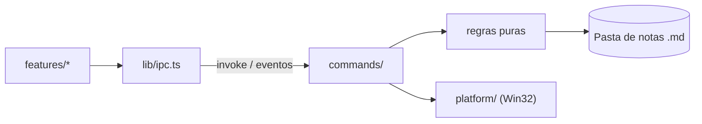

# Arquitetura

Estado atual e direção da etapa em curso. O que ainda não existe está marcado como _planejado_.

## Estrutura

```text
src/                     UI (Svelte 5 + Vite)
  App.svelte             Composição da tela, sem regra de negócio
  lib/ipc.ts             Único ponto que chama o Rust
  lib/features/<nome>/   Componentes, estado e testes de cada funcionalidade
  lib/ui/                Componentes visuais genéricos
  lib/styles/tokens.css  Cores, espaçamentos e tipografia
src-tauri/src/           Backend (Rust)
  lib.rs                 Só monta o app e registra módulos
  panel.rs               Máquina de estados pura do painel
  dock.rs                Thread que liga cursor, máquina de estados e janelas
  tray.rs                Bandeja, saída e início com o Windows
  main_window.rs         Cria a janela principal e limita sua navegação
  shortcut.rs            Atalho global do painel
  web.rs                 Janela da página web, com conteúdo não confiável
  notes.rs               Pasta, listagem, leitura segura de notas e imagens locais
  commands/              Comandos Tauri: camada fina que delega
  platform/              Código específico de sistema operacional
```

Crie pastas quando a primeira funcionalidade precisar delas.

A bandeja permite encerrar o app e controlar o início com o Windows; uma segunda instância apenas sai.

## Fluxo



## Painel

Protótipo da M0. `panel.rs` é uma máquina de estados pura, sem acesso ao Win32:

```text
Oculto → Armando (cursor na borda, aguardando) → Aberto → Fixado
Oculto → Chamado (pelo atalho) → Dispensado (cursor ainda na borda) → Oculto
```

`dock.rs` a liga à janela em uma única thread, que consulta o cursor, recebe os pedidos da UI e anima.
Assim, abrir, fechar e animar não disputam entre si. Coordenadas são pixels físicos, com consciência de
DPI por monitor (PMv2).

- **Gatilho:** consulta do cursor a cada 50 ms; a borda é a última coluna de pixels do monitor mais à
  direita, a única que segura o cursor, com pausa de 150 ms. Uma janela fina na borda roubaria cliques de
  barras de rolagem e botões de janelas maximizadas. Pontos fora desse monitor são ignorados.
- **Atalho:** `Ctrl+Alt+Espaço`, registrado pelo Rust, sem permissão na capability. Se o registro falhar,
  a falha vai para o log e o painel segue abrindo pelo cursor. Abre na hora e dá o foco ao painel; aberto
  pelo cursor, fecha; fixado ou com o seletor nativo aberto, não faz nada. O seletor é modal e religaria
  a janela do painel oculto.
- **Aberto pelo atalho:** quem manda é o foco, não o cursor. Fecha pelo atalho, por Esc com o painel em
  primeiro plano e sem campo em edição, ou quando o foco vai para outro app. A página em foco conta como
  foco no painel, e o seletor nativo o mantém aberto. Foco nulo, comum em transições do sistema, é
  ignorado. Depois de fechar assim, a borda só volta a valer quando o cursor sair dela.
- **Ativação pelo atalho:** a tecla dá ao processo o direito de usar `SetForegroundWindow`, desde que a
  janela já esteja habilitada. Se a ativação falhar, sem foco a perder, o painel passa a seguir a regra do
  cursor e não fica preso sobre as outras janelas.
- **Esc:** cada toque conta uma vez. O toque que sai de um campo ou fecha o seletor já teve dono e não
  fecha o painel junto, mesmo que a UI avise antes da consulta seguinte.
- **Expansão:** a janela já existe com o tamanho final, estacionada logo após a borda, e desliza com
  `SetWindowPos`, sem redimensionar o WebView. Cada quadro espera o `DwmFlush` e a posição vem do tempo
  real, com alvo de 150 ms.
- **Monitor vizinho:** a posição estacionada fica fora de todas as telas, porque não há monitor à direita
  do escolhido. A região da janela ainda é recortada a cada quadro; estacionada, ela fica vazia.
- **Foco:** a janela usa `WS_EX_NOACTIVATE` e `WS_EX_TOOLWINDOW` e, pelo cursor, abre sem ativar. O
  `pointerdown` na UI pede a ativação. A cada consulta do cursor, o painel guarda o último app em primeiro
  plano fora dele e do seletor nativo; ao fechar, o foco volta a esse app, salvo se o usuário já estiver
  em outro. Se ele não existir mais, o foco vai para a área de trabalho.
- **Página web:** janela própria (`web.rs`), possuída pelo painel, abaixo da barra do topo. A thread do
  painel a posiciona e a move com `DeferWindowPos`, na mesma transação da janela principal. Sem
  `WS_EX_NOACTIVATE`, porque a página não fala com o Rust: o clique ativa a janela pelo Windows.
  Fica fora da capability `main`, o Tauri recusa comandos de origem remota e `lib.rs` só aceita comandos da
  janela `main`; `__TAURI_INTERNALS__` existe na página, mas `invoke` falha. Só navega por http(s), fora das origens `*.localhost` do Tauri, e nunca abre outra janela: `target=_blank` e
  `window.open` navegam na própria janela da página.
- **Página em foco:** segura o painel aberto, como a edição na UI. Com o cursor fora, Esc devolve o foco
  ao app anterior e o painel fecha; com o cursor sobre ela, o Esc é da página. Como a página não fala com
  o Rust, a tecla é lida na consulta do cursor.
- **Painel oculto:** a janela fica desabilitada. Só `WS_EX_NOACTIVATE` não basta: ao fechar o app em
  primeiro plano, o Windows ativava o painel fora da tela e o teclado ia para uma janela invisível.
- **Painel recolhido (_planejado_):** o WebView2 reduz o uso de memória enquanto oculto.
- **Troca de monitores:** a cada consulta do cursor, o painel relê os monitores. Se layout, resolução, DPI
  ou barra de tarefas mudarem o monitor escolhido, as janelas vão para o novo lugar sem animação.

## Notas

`notes.rs` guarda a pasta escolhida em `settings.json`, na configuração do app, e lista os `.md`
recursivamente, sem pastas ocultas, symlinks ou junctions. A abertura valida o caminho e confere se o
destino canônico fica dentro da pasta. O seletor nativo mantém o painel aberto. A UI recebe texto cru pelo
IPC e não tem permissão de sistema de arquivos.

## Conteúdo não confiável

Decisões em [0004](decisions/0004-conteudo-nao-confiavel.md).

- **CSP:** em `tauri.conf.json`, vale só no build final. Em dev, a página vem direto do Vite, sem CSP.
- **Janela `main`:** `main_window.rs` a cria, navega só na origem da UI e não abre outra janela. Links em
  conteúdo renderizado não saem dela.
- **Imagens locais:** `http://note-asset.localhost/<caminho relativo>`, servidas por `notes.rs` só para a
  janela `main`. Imagens remotas ficam bloqueadas.
