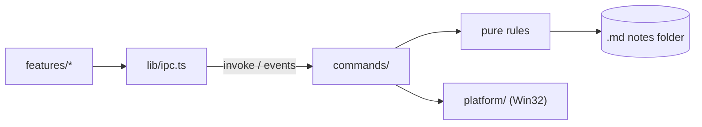

# Architecture

Current state and direction of the current stage. What does not yet exist is marked as _planned_.

## Structure

```text
src/                     UI (Svelte 5 + Vite)
  App.svelte             Screen composition, no business rules
  lib/ipc.ts             Only entry point that calls Rust
  lib/i18n.ts            Interface text in English and pt-BR, and error codes to text
  lib/features/<name>/   Components, state and tests for each feature
  lib/ui/                Generic visual components
  lib/styles/tokens.css  Colors, spacing and typography
src-tauri/src/           Backend (Rust)
  lib.rs                 Only assembles the app and registers modules
  panel.rs               Pure panel state machine
  dock.rs                Thread connecting cursor, state machine and windows
  tray.rs                Tray: screen side, exit and Windows startup
  main_window.rs         Creates the main window and limits its navigation
  shortcut.rs            Global panel shortcut
  web.rs                 Web page window, with untrusted content
  notes.rs               Folder, listing, safe reading and atomic saving of notes, leftovers, local images,
                         reading and editing `_pinned.md`
  pinned.rs              Pure line rules for `_pinned.md`: parse, pin, unpin, move
  i18n.rs                Interface language, from the Windows display language
  error.rs               Errors sent to the UI as codes
  watch.rs               Tells the UI when the notes folder changes
  commands/              Tauri commands: thin delegating layer
  platform/              Operating-system-specific code
```

Create folders when the first feature needs them.

The tray chooses the screen side, exits the app and controls Windows startup; a second instance simply
exits.

## Flow



## Language

Rust reads the Windows display language once at startup: any Portuguese gets pt-BR, everything else
English. The tray uses it directly and `app_locale` hands it to the UI, which sets it before mounting;
changing the Windows language takes effect on the next start. Commands fail with `{ code, ...fields }`
(`error.rs`), and `i18n.ts` turns each code into text; `detail` carries the operating system's message,
already in its language. An unknown code shows as an unexpected error with its raw fields.

## Panel

M0 prototype. `panel.rs` is a pure state machine, without Win32 access:

```text
Hidden → Arming (cursor at edge, waiting) → Open → Pinned
Open → Summoned (a click gives the panel or its page focus, or the shortcut)
Hidden → Summoned (by shortcut) → Dismissed (cursor still at edge) → Hidden
```

`dock.rs` connects it to the window on a single thread, which polls the cursor, receives UI requests and
animates. Thus opening, closing and animating do not compete. Coordinates are physical pixels, with
per-monitor DPI awareness (PMv2).

- **Side:** right by default, or left, chosen in the tray and saved in `settings.json`; a missing or
  unknown value means right. Everything below mirrors on the left. Switching moves the windows at once,
  without animation, keeping the panel open or closed.
- **Trigger:** cursor polling every 50 ms; the edge is the outer pixel column of the outermost monitor on
  the chosen side, the only one that holds the cursor, with a 150 ms pause. A thin window at the edge would steal clicks
  from scrollbars and maximized window buttons. Points outside that monitor are ignored.
- **Shortcut:** `Ctrl+Alt+Space`, registered by Rust, without permission in the capability. If registration
  fails, the failure is logged and the panel still opens by cursor. The machine never closes on it: hidden,
  opened by cursor or summoned, the panel opens at once if needed, takes focus and becomes summoned; pinned,
  it takes focus and stays pinned. Rust then emits `panel-search` with `toggle`, whether the panel window
  was already foreground before the press. The UI focuses the search bar and selects its text, or, with
  `toggle` and the bar already focused, asks to close (`panel_close`), which a pinned panel ignores.
  Deciding in the UI avoids mirroring the bar's focus in Rust; reading `toggle` before activating keeps a
  bar that kept DOM focus in a hidden or hover-opened panel from counting. With the native picker open,
  it does nothing: the picker is modal and would re-enable the hidden panel window.
- **Summoned (focus governs):** by the shortcut, or once a cursor-opened panel or its page becomes
  foreground (a click). Focus governs, not the cursor. It closes when the UI asks (`panel_close`: Esc in
  the empty search bar, or the shortcut there) or when focus moves to another app. A focused page counts as
  panel focus, and the native picker keeps it open. Null focus, common during system transitions, is
  ignored. After closing this way, the edge only takes effect again once the cursor leaves it. Without
  focus (hover only), the panel never takes it and closes when the cursor leaves.
- **Shortcut activation:** the key gives the process the right to use `SetForegroundWindow`, provided the
  window is already enabled. If activation fails, with no focus to lose, the panel follows the cursor rule
  and does not get stuck over other windows.
- **Esc:** in the panel window the UI owns it, layer by layer (see "Note list"), and only the last layer
  asks Rust to close, so no press both leaves a field and closes the panel. Rust reads the key only for
  a focused page, which does not talk to Rust, and counts each press once.
- **Focus band:** at each poll, Rust emits `panel-focus` (`focused`, `side`) when it changes: focused while
  the panel window or its page is foreground; null focus keeps the last report. The UI draws a 2 px accent
  band on the inner edge. DOM focus events cannot see the page window, a separate window, so polling is
  the source. The page window covers the band below the top bars.
- **Expansion:** the window already exists at its final size, parked just beyond the edge, and slides with
  `SetWindowPos`, without resizing the WebView. Each frame waits for `DwmFlush` and position follows real
  time, targeting 150 ms.
- **Neighboring monitor:** the parked position is outside all screens, because there is no monitor beyond
  the chosen one on that side. The window region is still clipped to the monitor's columns each frame;
  when parked, it is empty.
- **Focus:** the window uses `WS_EX_NOACTIVATE` and `WS_EX_TOOLWINDOW` and opens without activation by
  cursor. UI `pointerdown` requests activation, which makes the panel summoned at the next poll. At each cursor poll, the panel remembers the last foreground
  app outside itself and the native picker; on close, focus returns to that app unless the user is already
  in another. If it no longer exists, focus goes to the desktop.
- **Web page:** its own window (`web.rs`), owned by the panel, below the top bar. The panel thread positions
  and moves it with `DeferWindowPos`, in the same transaction as the main window. No `WS_EX_NOACTIVATE`,
  because the page does not talk to Rust: Windows activates the window on click. It is outside the `main`
  capability, Tauri rejects remote-origin commands and `lib.rs` accepts commands only from the `main`
  window; `__TAURI_INTERNALS__` exists on the page, but `invoke` fails. It navigates only over http(s),
  outside Tauri's `*.localhost` origins, and never opens another window: `target=_blank` and `window.open`
  navigate in the page window itself.
- **Focused page:** counts as panel focus, so the panel is summoned. With the cursor outside, Esc returns focus
  to the previous app and the panel closes; with the cursor over it, Esc belongs to the page. Since the page
  does not talk to Rust, the key is read during cursor polling.
- **Hidden panel:** the window is disabled. `WS_EX_NOACTIVATE` alone is not enough: when the foreground app
  closed, Windows activated the off-screen panel and the keyboard went to an invisible window. When the slide
  out ends, `dock.rs` emits `panel-hidden` to the UI (the page's `visibilitychange` does not fire for a
  window moved off-screen).
- **Collapsed panel (_planned_):** WebView2 reduces memory use while hidden.
- **Monitor changes:** at each cursor poll, the panel re-reads the monitors. If layout, resolution, DPI or
  taskbar changes the chosen monitor, the windows move to the new position without animation.

## Notes

`notes.rs` stores the chosen folder and the screen side in `settings.json`, in the app configuration, and lists `.md` files
recursively, excluding hidden folders, symlinks and junctions. Opening validates the path and checks that the
canonical target is inside the folder. The native picker keeps the panel open. Rust sends the raw text to the UI,
which has no filesystem permission. A closed YAML frontmatter block at the start is hidden; title and
tag scalars, flow lists and block lists are extracted as plain text by `features/notes/markdown.ts`.
The small parser ignores unsupported YAML; an unquoted `#` after whitespace starts a comment, while
quoted `#` and `a#b` are literal. The raw text remains unchanged.

**Search.** `features/notes/search.ts` keeps an in-memory index in the UI, a pure module without IPC.
`notes_list` carries each note's modified time (ms since the Unix epoch); `syncIndex` compares it with the
index and asks `notes_texts(paths)` only for new or changed notes, 200 at a time, then forgets removed
ones. `notes_texts` applies the `notes_open` path rules to each path and leaves out any note it cannot
read (missing, too large, not UTF-8, outside the folder) instead of failing the call; such a note stays
findable by name and is retried on the next sync. The caller syncs after each listing, one at a time, and
the `notes-changed` reread is the trigger. Title and tags come from `markdown.ts`'s frontmatter parser
([0007](decisions/0007-one-markdown-parser.md)); the title falls back to the file name, and the body is
the text after the frontmatter. Matching ignores case and accents (per-character folding, so offsets
map back to the original text) and requires every word somewhere in title, tags or body, as substrings.
Order: title equal to the query, title starting with it, a word in the title, a word in a tag, body only;
ties newest first. `search` also says whether a title equals the query (`exactTitle`, which decides
whether the UI offers "Create"), and gives each body match a short snippet of plain text with offsets for
highlighting, never HTML. An empty query lists every note by modified time. With 2000 notes of about
5 KB, building takes about 70–120 ms and a query a few ms; the full text index (FTS5) is not needed.

**Saving.** `notes_open` returns the raw text and a version: a hash of the file's bytes,
opaque to the UI and valid only within one run. `notes_save(path, content, base)` validates the path like
opening, writes only if the file still has version `base` and returns the new version; otherwise it
answers `conflict` and writes nothing. A missing note is recreated only on a save of an edit,
through a synced temporary file and `move_new`, which refuses replacement. Every parent component is
held against rename and checked for links; an unavailable parent is never created. An empty base token
explicitly expects absence: if another file took the deleted name, the save conflicts. Content equal to
the file counts as saved without writing. Text
goes to disk exactly as received, without touching line endings. Saves are serialized in Rust, and the
check is confirmed against the version actually replaced, so an external write that slips in is never
overwritten.

**Atomic writes.** Each write creates its files next to the target with unique names,
`<name>.<pid>-<n>.docdock-tmp` and `.docdock-bak`; the extension is not `.md`, so listing ignores
leftovers, and a write never deletes a file it did not create. `settings.json` is written to a synced
temporary file and renamed over the original; folder and side updates run load, change and save under one
lock. A note goes through `ReplaceFileW`, which keeps the file's identity, ACL and creation time and moves
the replaced file to the backup name. The backup is then opened without sharing: if it is still the base
version (or our text), it is deleted through that handle and the save succeeds. Otherwise, or if another
app still has it open, an external write slipped in: two renames put it back at the note, which works
while the other app holds it, our copy is deleted only if it still matches the text the editor keeps, and
the answer is `conflict`. When `ReplaceFileW` fails, the note keeps its name, or it is renamed back from
the backup (`ERROR_UNABLE_TO_MOVE_REPLACEMENT_2`). Any version that cannot be put back stays on disk and
the error names it. A file another app holds open without delete sharing cannot be replaced, and the save
fails.

**Autosave.** `features/notes/autosave.ts` saves the whole text after a pause in edits, with one save in
flight and the latest edit queued. `flush` saves at once and waits; on a conflict it stops saving and keeps
the edit in `unsaved()`, and after an error the next edit or `flush` retries. `stop` drops unsaved text and
ignores later edits and completion callbacks; an in-flight disk operation can still complete. The
editor stops it when replacing a clean base, discarding or unmounting.

**Rendering.** Reading and editing share one parser and one rule per construct
([0007](decisions/0007-one-markdown-parser.md)): `markdown.ts` configures lezer with GFM and GitHub
footnotes, and holds link, image, alert and frontmatter rules. `render.ts` turns the tree into a model
of allowlisted tags and attributes, then DOM nodes, rebuilt when the note or its path changes. Raw
HTML stays text; links and images follow the shared destination rules; footnote definitions render
where they are written.

**Editor.** The pencil in an expanded card's header, or Ctrl+E on the selected card, opens
`features/notes/Editor.svelte` with the whole raw text, including frontmatter, read fresh from disk. The one
editor is a snippet `Notes.svelte` hands to the edited card, which draws it in place of its content; it
grows with the text, and the list stays the only scroller. Ctrl+E reaches the
editor through its CodeMirror keymap and the card list through a window listener that ignores handled keys;
both use the same guarded leave path as Esc and the pencil. Formatting commands apply isolated history
transactions, editing only markers or selected line prefixes. A Compartment reconfigures the note-path
facet on rename, rebuilding relative-image decorations without replacing text or history. Autosave
state is reported to the card header's status. CodeMirror 6
parses GFM; `live-formatting.ts` decorates visible ranges on document, selection, parser and viewport
changes. Headings, emphasis, strikethrough, quotes, lists, rules, tasks, code and local images hide
syntax outside selection lines. Quotes nest up to three drawn bars; alerts and links follow the
reading parser (an alert marker alone on its line, `[text]` without a destination stays text). Lines and
widgets are spaced with padding only: CodeMirror maps clicks and vertical motion from measured line
boxes and ignores margins. Tables remain raw. Multiline image syntax is replaced one line at a time. Task checkboxes make
one undoable text transaction and respect read-only state. Image widgets use the same decoding,
traversal and segment encoding rules as the `note-asset` protocol; they never insert HTML. A StateField supplies
the block frontmatter replacement (title and tags); clicking or keyboard-activating it reveals the
framed raw block. Metadata is cached by immutable document identity. Raw text is tracked separately
from CodeMirror offsets so untouched CRLF, LF and CR
line endings, including mixed files, survive edits; new lines use the first existing separator (LF in
an empty file). No Markdown serialization occurs.

Each editor owns an autosave instance. Blur flushes. Every way out of editing goes through one guarded
leave that flushes and refuses on conflict or error: Esc, the toggle, closing the card or expanding
another (all through the list's level change), typing in the search, creating or restoring a note,
choosing a folder and `panel-hidden`. Pinning keeps editing. Leaving temporarily makes the editor read-only,
flushes and rereads the note from disk. Esc blurs synchronously, like TextField, and stops there.
Conflicts keep the text and stop saving;
Keep my version rereads the disk version and saves the latest editor text against it (another race
can conflict again). Discard my changes explicitly replaces the text from disk. Errors stay near
the editor, with Discard my changes available immediately for read or save failures too. A clean
external reload resets the autosave base and applies a minimal CodeMirror transaction as one isolated
history step. A raw-text state field and inverted history effects preserve exact mixed line endings
through reload, undo and redo, even when only line endings changed. Updated from disk offers Undo;
Ctrl+Z does the same. Undo becomes a normal edit saved against the new disk base;
pending or in-flight text is never replaced. An editor revision rejects reads started before an edit,
save completion or another reload.

**Pasted images.** Text in the clipboard takes precedence. Otherwise the editor sends the file as a
raw IPC body with a percent-encoded note path header. Rust validates the note with `resolve`, accepts
only PNG, JPEG, GIF and WebP magic signatures, and limits attachments to 10 MiB to bound disk use and
accidental large clipboard writes. It creates `attachments/pasted-YYYYMMDD-HHMMSS.<ext>` beside the note,
using local time and `-2`, `-3` suffixes for collisions. A synced temporary file becomes the final file
through `move_new`, never replacing an existing file. The attachment directory cannot be a reparse
point; open directory handles prevent replacement of it and its canonical ancestors during the write.
Note aliases with a different canonical parent are refused so the relative link remains correct.
The editor is read-only while the paste is pending, preserves the insertion selection, and waits for
it before leaving. Reloads are refused during that wait; insertion then creates an ordinary unsaved
Markdown edit protected by autosave's existing watcher guard. Errors use the existing editor notice.
The reading view resolves the inserted link through `markdown::image_url` and `note-asset`.

CodeMirror lives in an open ShadowRoot. In style-mod 4.1.4, only a root without `head` uses
`CSSStyleSheet` and `adoptedStyleSheets`; mounting directly in Document would inject a blocked style
tag. External CSS links load `content.css` (also imported by the reading view) and editor chrome inside
the shadow, with `:host` specificity above CodeMirror base styles. Chromium headless verified the production Vite output with the exact CSP header
from tauri.conf.json: one adopted sheet, zero runtime style tags, no CSP violations, and editor
creation, edits, conflict resolution and reloads after freezing Object.prototype before app startup.
WebView2 and native panel focus/Esc still require manual verification.

**External changes.** Listing a folder starts watching it (`watch.rs`, with `notify`); choosing a folder
stops the watch, so the next listing starts a fresh one even for the same path. Events are grouped until
200 ms of quiet, at most 1 s, and become one `notes-changed` event to the `main` window. Its
`renames` payload contains relative `/` markdown path pairs from paired or From/To notify events
(with matching trackers when supplied). Directory moves expand to markdown descendants. The UI
updates the selected/editor path and generation before rereading; outside-folder and non-markdown
destinations count as deletion. Changes inside hidden folders and to temporary or backup files of a save
do not count; lost events do. The UI then
rereads the folder, the listing (syncing the search index), `_pinned.md`, the text of every note shown as
preview or expanded, and the edited note, replacing a text only if its version changed; a read
that started before choosing a folder or renaming the open note is dropped and redone. An expanded note
that disappeared keeps its last content on screen as a card with a notice; a pinned one becomes "note not
found". While editing, deletion neither
reports an error nor schedules a write by itself; pending edits or the next edit recreate it. Leaving
a clean deleted editor creates nothing. A name taken after observed deletion conflicts on the next save.
While editing, only a clean editor accepts the new text, as described above; saving compares the loaded
disk version before writing.

**Leftovers.** A save that stops between its two renames, for example when the app closes, leaves
`.docdock-bak` files and may leave the note name empty. Opening a folder lists every
`<note>.md.<pid>-<n>.docdock-bak` outside hidden folders, under the save lock so a save in progress is not
mistaken for one. Restoring renames the backup to the note name, or to `<stem> (recovered).md`,
`(recovered 2)` and so on (pt-BR: `recuperada`) if the name is taken. Nothing is overwritten or deleted;
the user compares the copies and removes the extra one.

## Note list

Spec in `docs/DESIGN.md` ("Note list"). `features/notes/list.ts` is the pure model: `buildList` takes the
search hits, the pinned items and the expanded path and gives the "Create" text, the Pinned entries in
`_pinned.md` order (cards, plus "missing" entries while not searching) and the Notes cards in search order
without the pinned ones; `navKeys`, `defaultKey`, `move` and `enter` say what the arrows and Enter select
and activate, `deeper`/`shallower` the next card level, and `noteFileName` the file for a new note. No IPC.
`Notes.svelte` runs the effects and draws it with `Card.svelte` (one card in every state, rows included)
and `Highlight.svelte` (snippet text and matches as separate nodes, never HTML).

- **Data:** one `search.ts` index, synced after each `notes_list`, serialized; `pinned_list` after each
  `notes-changed`. A card in preview or expanded needs its raw text, read with `notes_open` into
  `contents` and refreshed on `notes-changed`; entries nobody shows are dropped. Web items of
  `_pinned.md` are skipped until M4.
- **State:** one `expanded` path (not remembered: `panel-hidden` clears it once editing is left);
  `selection` for the arrows, reset by typing, with the first match (else "Create") selected while a
  query exists. Line against open of a pinned card goes through `pinned_set_collapsed`; expanding a
  collapsed card also opens it.
- **Keyboard:** one `listKey` handles the list keys from the bar's keydown, in capture phase, and from a
  window listener for keys typed anywhere else except a text field or the editor (found through
  `composedPath`, since the editor sits in a shadow root). → and ← in the bar act on the selected card only
  with the caret at the end of the text. Esc goes in layers: while editing, it leaves editing (from the
  editor through its keymap, or from a button) and the card header takes the focus; next, it clears the
  search and focuses the bar; from the empty bar it calls `panel_close`. Outside a field, a printable key
  other than Space focuses the bar, which then receives it; Ctrl+F focuses the bar and selects its text
  from anywhere but a field. ↑ and ↓ on an expanded selected card ask `arrowScroll` (pure, in `list.ts`)
  whether to scroll the list about three lines or move the selection; Alt moves directly. Without a
  folder only Esc is handled, so buttons keep Enter.
- **Editing:** the edited card is the expanded one. `buildList` keeps it as a card while editing even
  when the search hides it (first in its section) or its pinned note goes missing. `rows` flattens both
  sections into one keyed block, and the edited card's key is fixed, so pinning, an edit of
  `_pinned.md` or a rename moves the card instead of rebuilding it, which would drop the editor with
  its unsaved text.
- **Creating:** `notes_save(name, "", "")` at the folder root with `noteFileName` (no separators, drive or
  `..`, no device names, case-insensitive uniqueness, never `_pinned.md`); a conflict because another app
  took the name tries the next number. The empty file's title is its name.
- **Pin button:** a bookmark `IconButton` "Pin note to top" in pinned cards and in expanded cards, distinct
  from the header's "Pin panel" thumbtack. Card actions use its `quiet` prop; the bookmark fills when
  pressed. The root `_pinned.md` entry is skipped by `search` for both empty and nonempty queries.
- **Rendering:** expanded cards reuse `renderNote` with no height limit; the sticky header relies on the
  list being the only scroller. Previews cap at about eight lines and fade only when clipped.

## Pinned items

Decision in [0005](decisions/0005-pinned-items.md). `pinned.rs` is pure: text in, text out. An item is a
single-line list entry (`-`, `*`, `+`, `1.`) whose first link is a relative note path (`%20` decoded, a
leading `./` and any `#fragment` dropped) or an http(s) URL; images, other schemes, anchors and lines
that are not list items are ignored, as are lines inside fenced code blocks and HTML comments. Edits move whole lines and never rewrite the file: each line keeps
its own terminator (CRLF, LF, CR, mixed) and everything that is not an item stays byte for byte.
Pinning adds one `- [title](path)` line after the last item, or at the end of the file if there is
none, with the file's first line terminator (LF in an empty file); an item already pinned (notes compare
case-insensitively, URLs in their written, escaped form) changes nothing. Unpinning removes every line pointing to the target. Moving trades
the item lines among themselves, so headings and prose between items stay where they are.

`notes.rs` reads and writes the file. An edit reads `_pinned.md` with its version, applies the line edit
and saves through `save_note_in`, the same atomic path as notes. If the file changed in between, it is
read again and the edit reapplied to the new text; after three losses it fails with `pinnedChanged` and
writes nothing. A missing file is created. A note item whose path no longer resolves to a note inside the
folder is reported `missing`. Targets are the keys: `pinned_*` commands (`pinned_list`, `_add`, `_remove`,
`_move`, `_set_collapsed`, `_restore`) all answer with the state after the change. Which items are
collapsed to one line is a set of targets in `settings.json`, per computer, changed under the same lock as
the folder and side; removing an item forgets its entry.

**Restore.** Each time `_pinned.md` is read, its text is kept in `pinned-copy.json` in `app_config_dir`,
with the folder it came from (one slot, following the folder in use); reading and updating the copy run
under one lock, so a slower read never replaces the copy of a newer one. If the file is gone and the copy
for this folder has content, the state says `restorable`; restoring recreates the file through the empty
base of `save_note_in`, which never replaces an existing file. Pinning something instead creates a new file
holding only that item, and the next read replaces the copy.

**External changes.** `_pinned.md` is a note in the folder, so the existing `notes-changed` event covers
it (no new watcher); the UI rereads with `pinned_list` then.

## Untrusted content

Decisions in [0004](decisions/0004-untrusted-content.md).

- **CSP:** in `tauri.conf.json`, applies only in the production build. In dev, the page comes directly from Vite, without CSP.
- **`main` window:** `main_window.rs` creates it, navigates only within the UI origin and opens no other window. Links in rendered content do not navigate away from it.
- **Rendered notes:** DOM nodes from an allowlisted model, never HTML. GitHub alerts become
  `markdown-alert-{note,tip,important,warning,caution}` blockquotes; shared CSS supplies literal English
  kind titles, and the editor uses text widgets and line decorations for the same kinds.
- **Local images:** `http://note-asset.localhost/<relative path>`, served by `notes.rs` only to the `main` window. Remote images are blocked.
