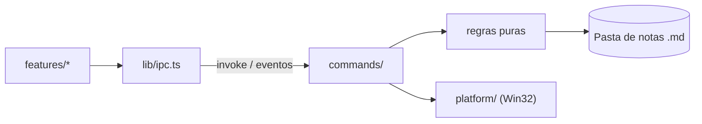

# Arquitetura

Estado atual e direção da etapa em curso. O que ainda não existe está marcado como _planejado_.

## Estrutura

```text
src/                     UI (Svelte 5 + Vite)
  App.svelte             Composição da tela, sem regra de negócio
  lib/ipc.ts             Único ponto que chama o Rust
  lib/features/<nome>/   Componentes, estado e testes de cada funcionalidade
  lib/ui/                Componentes visuais genéricos
  lib/styles/tokens.css  Cores, espaçamentos e tipografia
src-tauri/src/           Backend (Rust)
  lib.rs                 Só monta o app e registra módulos
  commands/              Comandos Tauri: camada fina que delega
  platform/              Código específico de sistema operacional
```

Crie pastas quando a primeira funcionalidade precisar delas.

## Fluxo



## Painel (_planejado_)

O painel é uma máquina de estados pura, alimentada por eventos e sem acesso ao Win32:

```text
Oculto → Armando (cursor na borda, aguardando) → Aberto → Fixado
```

- **Gatilho:** consulta periódica do cursor, com pausa curta na borda. Uma janela fina na borda
  roubaria cliques de barras de rolagem e botões de janelas maximizadas.
- **Expansão:** a janela já existe com o tamanho final e desliza para dentro da tela.
- **Foco:** a janela abre sem ativar; só recebe foco quando o usuário clica para editar.
- **Painel recolhido:** o WebView2 reduz o uso de memória enquanto oculto.
