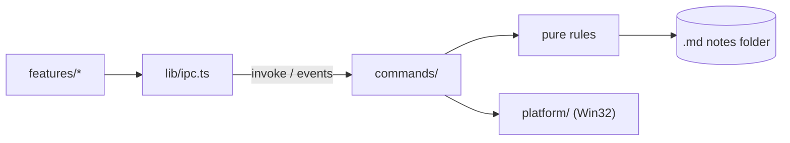

# Architecture

Current state and direction of the current stage. What does not yet exist is marked as _planned_.

## Structure

```text
src/                     UI (Svelte 5 + Vite)
  App.svelte             Screen composition, no business rules
  lib/ipc.ts             Only entry point that calls Rust
  lib/features/<name>/   Components, state and tests for each feature
  lib/ui/                Generic visual components
  lib/styles/tokens.css  Colors, spacing and typography
src-tauri/src/           Backend (Rust)
  lib.rs                 Only assembles the app and registers modules
  panel.rs               Pure panel state machine
  dock.rs                Thread connecting cursor, state machine and windows
  tray.rs                Tray: screen side, exit and Windows startup
  main_window.rs         Creates the main window and limits its navigation
  shortcut.rs            Global panel shortcut
  web.rs                 Web page window, with untrusted content
  notes.rs               Folder, listing, safe reading of notes and local images
  commands/              Tauri commands: thin delegating layer
  platform/              Operating-system-specific code
```

Create folders when the first feature needs them.

The tray chooses the screen side, exits the app and controls Windows startup; a second instance simply
exits.

## Flow



## Panel

M0 prototype. `panel.rs` is a pure state machine, without Win32 access:

```text
Hidden → Arming (cursor at edge, waiting) → Open → Pinned
Hidden → Summoned (by shortcut) → Dismissed (cursor still at edge) → Hidden
```

`dock.rs` connects it to the window on a single thread, which polls the cursor, receives UI requests and
animates. Thus opening, closing and animating do not compete. Coordinates are physical pixels, with
per-monitor DPI awareness (PMv2).

- **Side:** right by default, or left, chosen in the tray and saved in `settings.json`; a missing or
  unknown value means right. Everything below mirrors on the left. Switching moves the windows at once,
  without animation, keeping the panel open or closed.
- **Trigger:** cursor polling every 50 ms; the edge is the outer pixel column of the outermost monitor on
  the chosen side, the only one that holds the cursor, with a 150 ms pause. A thin window at the edge would steal clicks
  from scrollbars and maximized window buttons. Points outside that monitor are ignored.
- **Shortcut:** `Ctrl+Alt+Space`, registered by Rust, without permission in the capability. If registration
  fails, the failure is logged and the panel still opens by cursor. It opens immediately and focuses the
  panel; if opened by cursor, it closes; if pinned or the native picker is open, it does nothing. The
  picker is modal and would re-enable the hidden panel window.
- **Opened by shortcut:** focus governs, not the cursor. It closes via the shortcut, Esc with the panel in
  the foreground and no field being edited, or when focus moves to another app. A focused page counts as
  panel focus, and the native picker keeps it open. Null focus, common during system transitions, is
  ignored. After closing this way, the edge only takes effect again once the cursor leaves it.
- **Shortcut activation:** the key gives the process the right to use `SetForegroundWindow`, provided the
  window is already enabled. If activation fails, with no focus to lose, the panel follows the cursor rule
  and does not get stuck over other windows.
- **Esc:** each press counts once. The press that leaves a field or closes the picker has already been
  handled and does not also close the panel, even if the UI reports it before the next poll.
- **Expansion:** the window already exists at its final size, parked just beyond the edge, and slides with
  `SetWindowPos`, without resizing the WebView. Each frame waits for `DwmFlush` and position follows real
  time, targeting 150 ms.
- **Neighboring monitor:** the parked position is outside all screens, because there is no monitor beyond
  the chosen one on that side. The window region is still clipped to the monitor's columns each frame;
  when parked, it is empty.
- **Focus:** the window uses `WS_EX_NOACTIVATE` and `WS_EX_TOOLWINDOW` and opens without activation by
  cursor. UI `pointerdown` requests activation. At each cursor poll, the panel remembers the last foreground
  app outside itself and the native picker; on close, focus returns to that app unless the user is already
  in another. If it no longer exists, focus goes to the desktop.
- **Web page:** its own window (`web.rs`), owned by the panel, below the top bar. The panel thread positions
  and moves it with `DeferWindowPos`, in the same transaction as the main window. No `WS_EX_NOACTIVATE`,
  because the page does not talk to Rust: Windows activates the window on click. It is outside the `main`
  capability, Tauri rejects remote-origin commands and `lib.rs` accepts commands only from the `main`
  window; `__TAURI_INTERNALS__` exists on the page, but `invoke` fails. It navigates only over http(s),
  outside Tauri's `*.localhost` origins, and never opens another window: `target=_blank` and `window.open`
  navigate in the page window itself.
- **Focused page:** keeps the panel open, like editing in the UI. With the cursor outside, Esc returns focus
  to the previous app and the panel closes; with the cursor over it, Esc belongs to the page. Since the page
  does not talk to Rust, the key is read during cursor polling.
- **Hidden panel:** the window is disabled. `WS_EX_NOACTIVATE` alone is not enough: when the foreground app
  closed, Windows activated the off-screen panel and the keyboard went to an invisible window.
- **Collapsed panel (_planned_):** WebView2 reduces memory use while hidden.
- **Monitor changes:** at each cursor poll, the panel re-reads the monitors. If layout, resolution, DPI or
  taskbar changes the chosen monitor, the windows move to the new position without animation.

## Notes

`notes.rs` stores the chosen folder and the screen side in `settings.json`, in the app configuration, and lists `.md` files
recursively, excluding hidden folders, symlinks and junctions. Opening validates the path and checks that the
canonical target is inside the folder. The native picker keeps the panel open. Rust converts and sanitizes
markdown before sending it to the UI, which has no filesystem permission.

## Untrusted content

Decisions in [0004](decisions/0004-untrusted-content.md).

- **CSP:** in `tauri.conf.json`, applies only in the production build. In dev, the page comes directly from Vite, without CSP.
- **`main` window:** `main_window.rs` creates it, navigates only within the UI origin and opens no other window. Links in rendered content do not navigate away from it.
- **Local images:** `http://note-asset.localhost/<relative path>`, served by `notes.rs` only to the `main` window. Remote images are blocked.
