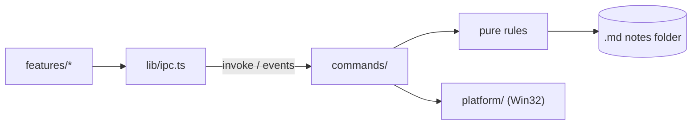

# Architecture

How the system works: modules, how they connect and the invariants that span them. Details of each
module are in its code comments, visible behavior in `docs/DESIGN.md` and why costly choices were made
in `decisions/`.

## Structure

```text
src/                     UI (Svelte 5 + Vite)
  App.svelte             Screen composition, no business rules
  lib/ipc.ts             Only entry point that calls Rust
  lib/i18n.ts            Interface text in English and pt-BR, and error codes to text
  lib/clipboard.ts       Copy and cut kept out of clipboard history and cloud clipboard
  lib/theme.svelte.ts    Theme setting applied as the root color scheme
  lib/features/<name>/   Components, state and tests: notes, web, tab (edge tab), preferences,
                         tweak-panel (development builds only)
  lib/ui/                Generic visual components
  lib/styles/tokens.css  Colors, spacing and typography
src-tauri/src/           Backend (Rust)
  lib.rs                 Only assembles the app and registers modules
  main_window.rs         Creates the main window and limits its navigation
  panel.rs               Pure panel state machine
  handle.rs              Pure edge handle rules: where it sits, when it shows, which stretch opens
  motion.rs              Slide duration and easing; tunable live in development builds
  dock.rs                Thread connecting cursor, state machine and windows
  tray.rs                Tray: icon, screen side, exit and Windows startup
  shortcut.rs            Global panel shortcut
  web.rs                 Web page window, with untrusted content
  blocking.rs            Content blocking in the page window: filter lists, engine and hiding scripts
  permissions.rs         Site permission requests of the page window: rules, remembered choices, waiting
  reader.rs              Reader view: the page's article as Markdown
  screenshot.rs          Pure page capture rules: full-page clip, size limits, image validation
  notes.rs               Notes folder, settings, listing, reading, atomic saving, renaming, moving,
                         deleting with undo, leftovers, local images and `_pinned.md` reads and writes
  pinned.rs              Pure line rules for `_pinned.md`
  attachments.rs         Pure reference matching for attachment images
  trash.rs               The notes folder's own 30-day trash for deletes without a Recycle Bin
  i18n.rs                Interface language, from the Windows display language
  error.rs               Errors sent to the UI as codes
  watch.rs               Tells the UI when the notes folder changes, leaves or returns
  updates.rs             Update check, download and the exit gate shared with Quit
  spelling.rs            Editor spell checking on its own thread, across the user's languages
  dev.rs                 Tweak window backend, development builds only
  commands/              Tauri commands: thin delegating layer
  platform/              Operating-system-specific code
```



## Shared rules

- **Commands** are accepted only from the `main` window (`main_only` in `lib.rs`); events go to it
  with `emit_to`. Errors are `{ code, ...fields }` (`error.rs`) and `i18n.ts` turns each code into
  text; `detail` carries the operating system's message. Commands that touch the notes folder run off
  the main thread, since an offline share can take seconds to answer.
- **Settings** live in `settings.json` in the app configuration directory and hold only preferences
  and the folder path, never note content or names ([0009](decisions/0009-note-privacy.md)). One
  locked writer loads, changes and saves them atomically; a missing or invalid field falls back to
  its default without invalidating the others. State that changes at runtime (site exceptions and
  permissions) is published to memory only after a successful save, and handlers read only memory.
- **Language:** Rust reads the Windows display language once at startup (any Portuguese gives pt-BR,
  everything else English); the tray uses it and the UI receives it before mounting.
- **Theme:** `system`, `light` or `dark`, read before mounting and applied as the root `color-scheme`,
  which tokens and the editor's shadow root inherit. Native windows receive it too, and Tauri forwards
  Windows theme changes to WebView2, including pages' `prefers-color-scheme`.

## Panel

`panel.rs` is a pure state machine; `dock.rs` drives it on one thread that polls the cursor every
50 ms, receives UI requests and animates, so opening, closing and animating never compete.
Coordinates are physical pixels with per-monitor DPI awareness (PMv2).

```text
Hidden → Arming (cursor at edge, waiting) → Open → Pinned
Open → Summoned (a click gives the panel or its page focus, or the shortcut)
Hidden → Summoned (by shortcut) → Dismissed (cursor still at edge) → Hidden
```

- **Windows:** `main` holds the UI; the web page is its own window (`web.rs`), owned by the panel
  ([0003](decisions/0003-panel-and-web-pages.md)). Both exist at their final size, parked beyond the
  screen edge, and slide together in one `DeferWindowPos` transaction, frame by frame after
  `DwmFlush`, along the curves in `motion.rs`; the WebView is never resized. The parked position lies
  outside every screen, and the window region is clipped to the monitor's columns each frame (empty
  while parked). Layout, resolution, DPI or taskbar changes, read at each poll, move the windows
  without animation.
- **Trigger and edge handle:** pure rules in `handle.rs` decide the outermost monitor on the chosen
  side, the activation stretch, the reveal area, the rush and where the cursor counts as inside the
  panel (including taskbars and app bars in its columns, until they are used). The handle is the
  panel's tab, drawn by the panel's own WebView (`features/tab/EdgeTab.svelte`): `main` is
  transparent and wider than the panel by the tab's depth, and `SetWindowRgn` shapes it to the panel
  plus the tab's outline so clicks beside the tab reach the windows below. Rust gives the UI the tab's
  size (`panel_tab_shape` and the `panel-tab-shape` event), so the geometry has one source. Because
  the viewport reaches beyond the panel, the UI places dialogs, menus and tooltips within the
  panel's columns (`ui/place.ts`). While parked the window is click-through
  (`WS_EX_LAYERED | WS_EX_TRANSPARENT`); only the open, resting tab takes clicks, sent as `panel_tab`.
- **Focus:** the window has `WS_EX_NOACTIVATE` and `WS_EX_TOOLWINDOW` and opens by cursor without
  activation. A UI `pointerdown` requests activation, so the panel becomes summoned at the next poll;
  then focus governs, not the cursor, and the panel closes when focus moves to another app or the UI
  asks (`panel_close`). A focused page counts as panel focus; null focus, common during system
  transitions, is ignored. Pinned, neither cursor nor focus closes it. Each poll remembers the last
  foreground app outside the panel, which gets focus back on close.
- **Hidden panel:** the window is disabled, because when the foreground app closed, Windows activated
  the off-screen panel despite `WS_EX_NOACTIVATE`. After the slide out, `dock.rs` ends the session
  (Undo copies, shortcut recording, trash purge) and emits `panel-hidden`.
- **Esc:** in `main` the UI owns it, one layer at a time, and only the last layer asks Rust to close.
  Rust reads the key only for a focused page, which has no channel to Rust.
- **Focus band:** Rust emits `panel-focus` when the panel window or its page gains or loses the
  foreground; DOM focus events cannot see the page window.
- **Shortcut** (`shortcut.rs`): registered by Rust as virtual keys, so the UI's physical key is
  mapped to the layout's key first (`platform/keyboard.rs`). Validation is a pure function. Recording
  unregisters the current combination and always ends: on losing the foreground or hiding, after 30
  seconds, or when a reloaded UI reads the state. A saved combination that fails at startup falls
  back to the default for the session. The press never closes the panel by itself: Rust emits
  `panel-search` with whether the panel was already foreground, and the UI decides between focusing
  the search bar and asking to close. The key also grants `SetForegroundWindow`; if activation still
  fails, the cursor rule applies. With the native folder picker open, the shortcut and the tab do
  nothing: the picker is modal and would re-enable the hidden window.
- **Capture exclusion** ([0009](decisions/0009-note-privacy.md)): `platform/capture.rs` sets
  `WDA_EXCLUDEFROMCAPTURE` (or `WDA_MONITOR` before Windows 10 2004) on each top-level window while it
  is still hidden, including every recreation of the page window. Best effort: failures are logged.
  Chromium-native popups (the default context menu, `<select>` lists) are separate windows it does not
  reach.
- **Memory while parked:** `platform/memory.rs` sets WebView2's memory target to low on both webviews
  while parked and back to normal when a slide starts; `dock.rs` derives the level from that state.
  Scripts keep running, so autosave and file events stay live; `TrySuspend` would pause them.
- **Tweak window** (development builds only, `dev.rs`): a `tweak` window on the same UI page with
  event permissions only; app commands still reject it. It sends its state to the panel as
  `tweak-state`, and `dock.rs` reads the live tuning, or the constants in release builds, once per
  poll. Release builds contain neither the module, the commands nor the frontend code. Its UI is in
  "Tweak window" in `docs/DESIGN.md`.
- **Limit:** the panel works over windowed and borderless full-screen apps, not exclusive-mode games.

## Tray, startup and updates

`tray.rs` and Preferences share the screen side and Windows startup operations, and each emits an event
so the other follows. Startup is the `DocDock` value in the current user's `Run` key
(`platform/autostart.rs`), quoted, never duplicated in `settings.json`; changing it clears Task
Manager's earlier choice, and at startup an entry naming a missing or unquoted executable is pointed at
the running one. The tray glyph follows the taskbar's theme and DPI (`platform/taskbar.rs`). A second
instance exits.

`updates.rs` checks at production startup, every six hours and on Windows resume; development builds
disable updates. Triggers share one check or download, and Rust verifies the download and keeps it in
memory. Quit and update share a native exit gate: an event asks the UI to freeze input and finish the
editor through its save guard, and only its acknowledgement allows exit; busy operations, save errors
and conflicts keep the process open ([0008](decisions/0008-distribution.md)). Windows NSIS relaunches
after installing.

To cut a release, align package, Cargo and Tauri versions and `Cargo.lock`, commit, push through normal
review, then manually run Release on main; the workflow rejects mismatched versions or a stale
`Cargo.lock` before signing. Inspect the draft's assets and publish it as a regular latest release;
never publish an older draft as latest after a newer one. Local release builds also need
`TAURI_SIGNING_PRIVATE_KEY` (file path or contents) and the matching password variable. `pnpm icons`
rebuilds the bundle icons and tray glyphs from `src-tauri/icons/source/`.

## Notes

### Folder and its availability

`notes.rs` lists `.md` files recursively, skipping hidden folders, symlinks and junctions. A subfolder
that cannot be read is skipped and reported (`skipped`); the UI keeps what it knew from it
(`features/notes/listing.ts`) instead of treating it as deleted. Rust sends raw text to the UI, which
has no filesystem permission.

A locked vault, an unplugged drive or an offline share takes the folder away, and creating it again
would write plaintext under a vault's mount point ([0009](decisions/0009-note-privacy.md)). So:

- `notes_folder` reports `available`, `unavailable` or `missing` (pure `availability`): available only
  if it lists, missing only when its parent lists without it.
- The folder carries an identity marker, `.docdock/folder-id`, and `settings.json` records the id
  expected. Choosing a folder is the trusted moment that adopts or creates it; a folder whose marker
  is absent or different is `unrecognized`, never written to or marked automatically, until the user
  confirms it (`notes_trust`). Settings from before markers adopt an existing one. Pure rule:
  `identity`.
- Every command starts from `root`, which opens the folder, checks the marker and holds the handle
  until the command ends, so the folder cannot be renamed or deleted meanwhile. No write path creates
  the folder or its parents.
- Accepted gaps, outside 0009's threats: writes still go by path, so a forced unmount between the
  check and a write, or a junction redirected after the check, can affect one write. Handle-relative
  writes would close them at a cost not justified today.
- `watch::monitor` checks the state every 2 s and emits `notes-changed` on a change. On leaving, the UI
  (`folderAction` in `features/notes/folder-state.ts`) forgets every note's text, name and tag, and
  Rust forgets what it keeps for Undo. The one exception is an editor with unsaved text, which stays
  in memory until saved on return or discarded.

### Writing without losing content

- **Versions:** `notes_open` returns the raw text and a version (a hash of the bytes, valid in one
  run). `notes_save` writes only if the file still has the base version and answers `conflict`
  otherwise; saves are serialized and the check is confirmed against the version actually replaced.
  An empty base expects absence. Text goes to disk exactly as received.
- **Atomic writes:** temporary and backup files sit beside the target with a non-`.md` extension, and a
  write never deletes a file it did not create. A note goes through `ReplaceFileW`; if the backup is
  not our base version, an external write slipped in and is put back. Settings and derived state use a
  synced temporary file and rename.
- **New files** go through `move_new`, which never replaces an existing file. Parent folders are held
  against rename and checked for links while writing.
- **Leftovers:** a save interrupted between its renames leaves a `.docdock-bak`. Opening a folder lists
  them and offers to restore each under a free name; nothing is overwritten or deleted.
- **Autosave** (`features/notes/autosave.ts`): one save in flight, the latest edit queued; a conflict
  stops saving and keeps the text. Every way out of editing goes through one guarded leave that
  flushes and refuses on conflict or error, including hiding the panel, choosing a folder, Quit and
  updating.
- **External changes:** `watch.rs` groups `notify` events into one `notes-changed` with the renames it
  could pair. The UI follows renames, then rereads the listing, `_pinned.md` and the notes it shows;
  only a clean editor takes new text. Reads started before a folder change or rename are dropped.

### Rename, move and delete

- **Rename and move** share one move (`relocate`) under the save lock with a version check; a taken
  name answers `renameConflict`, and pinned items and collapsed state follow. The editor holds saves
  while a move runs, so none reaches the old path. A move rewrites the note's relative links for its
  new folder (`movedLinks` in `features/notes/links.ts`), as an edit in the editor or a versioned save
  that never recreates the note. Links in other notes are not rewritten.
- **Delete** goes to the Recycle Bin (`platform/recycle.rs`), whose copy is read back and kept in
  memory for Undo until the panel hides; meanwhile the path is reserved, so a late save cannot
  recreate it. Where the bin would delete for good (a vault, a network share, a full bin), the item
  goes to the folder's own trash (`trash.rs`), inside the notes folder, kept 30 days, restorable from
  Preferences; the shell's decision for each item is final (bin missing, item over its limit or bin set
  to delete at once). Folders go the same way, with Undo only from the trash. Pinned items are removed
  and Undo restores them.
- **A note's images** go with it in the same command, under the save lock and after the note: those in
  `attachments/` folders that it references and no other note does, live or in the trash, by the
  reference rule of "Unused images" (`images_only_in`). Any doubt keeps them, such as a note that
  cannot be read; so do an image the bin refuses, one over 10 MB (too large to keep for Undo) or a
  failed move, and the delete still succeeds, saying images were kept. To the bin, their bytes are
  read back and kept with the note's, their paths reserved too; to the trash, they join the note's
  entry ([0013](decisions/0013-trash-entries-with-images.md)). Undo and restore bring them back to
  their own paths and refuse with `restoreTaken`, moving nothing, if a file took one's name.

### Unused images

The cleanup considers PNG, JPEG, GIF and WebP files under folders named `attachments` at any depth,
ignoring case and skipping hidden folders, symlinks and junctions. An image is in use if a Markdown
or HTML link resolves to it relative to the note, or the note contains its filename as a substring.
Matching ignores case and recognizes percent encoding. Notes in the folder's trash use their
original paths, including notes inside deleted folders. The scan reads Markdown text in Rust and keeps
it in memory only. A scan that cannot read a note or folder stops. Before moving any selected image,
Rust scans again under the save lock and skips images now in use.

### Pinned items

Decision in [0005](decisions/0005-pinned-items.md). `pinned.rs` is pure text in, text out, and keeps
every non-item byte and line terminator. `notes.rs` reads and writes the file with the notes' atomic
replacement: pin and unpin retry on a concurrent change, while reordering requires the displayed
version and fails with `pinnedChanged` otherwise. Collapsed state and the restore copy live in
`.docdock/` inside the notes folder; older AppData copies migrate once the folder is available and
recognized.

### Search and list

`features/notes/search.ts` keeps an in-memory index in the UI, synced from `notes_list` modification
times and `notes_texts`; nothing about tags or text is persisted. `query.ts` parses free text, `#tag`
and `date:` tokens (rules in "Search filters" in `docs/DESIGN.md`). `features/notes/list.ts` is the pure
model of cards, sections and keyboard actions; `Notes.svelte` runs the effects. The edited card keeps a
fixed key, so pinning, a `_pinned.md` change or a rename moves it instead of rebuilding the editor.
`tauri.conf.json` disables native file-drop interception, so HTML drag and drop (pin reordering) works.

### Rendering and editing

Both views use one parser ([0007](decisions/0007-one-markdown-parser.md)). Reading turns the syntax tree
into an allowlisted model of DOM nodes, never HTML. The editor is CodeMirror 6 in an open shadow root,
because its styles must load as adopted or linked sheets under the CSP. It tracks raw text apart from
CodeMirror's offsets so mixed line endings survive edits, reloads, undo and redo; no Markdown is
serialized. Code fences load local Lezer grammars on demand (`code-colors.ts`) for both views.

**Spelling** uses the Windows Spell Checking API (`spelling.rs`), not WebView2's checker, which drops
its marks whenever CodeMirror redraws a line and checks only WebView2's languages. The UI sends single
words, never note text, and a word is misspelled only when every language flags it.

**Pasted images** arrive as a raw IPC body; Rust checks the signature and size and writes them to
`attachments/` beside the note with `move_new`. **Copy and cut** in `main` go through
`lib/clipboard.ts` and `platform/clipboard.rs`, which mark the text to stay out of clipboard history
and cloud clipboard.

### Note content on disk

`main` runs InPrivate (`incognito(true)`); the page window keeps a normal profile under
`%LOCALAPPDATA%/com.jeffono.docdock/EBWebView`. Note text reaches the UI through IPC and becomes DOM
nodes, `note-asset` answers with `no-store`, and release builds use no `localStorage`, IndexedDB,
service workers or Cache Storage (only the development tweak window keeps presets in `localStorage`).
These are source-level guarantees: GPU caches, crash dumps and paging are the runtime's, and the app
never deletes the shared profile, which would erase website sessions.

## Untrusted content

Decisions in [0004](decisions/0004-untrusted-content.md) (CSP, `main` navigation, `note-asset` and
capabilities) and [0003](decisions/0003-panel-and-web-pages.md) (the page window).

- **Page window IPC (as of Tauri 2.12.5):** Tauri injects its scripts into every WebView and frame, so
  pages see `window.ipc` and `__TAURI_INTERNALS__.invoke`, but every call fails: no capability names
  the `web` window, so the ACL rejects plugin and core commands and remote-origin app commands, and
  `main_only` rejects local-origin ones (the dev UI or `note-asset` loaded in the page). Never grant
  the `web` window a capability. Plugins must not add init scripts that change web APIs:
  `tauri-plugin-dialog` replaced the page's `alert` and `confirm`, so native dialogs use `rfd`, and
  opener's link script is disabled.
- **Navigation guard:** `on_navigation` sees only the main frame, so `platform/guard.rs` cancels iframe
  navigations to app origins and every external scheme launch. The page window is created blank and
  navigates only after the guard, observers, content blocking, permission handler and mobile identity
  are installed; one lock covers the open, and a window whose setup failed is never navigated.
- **Reading from the page:** Rust evaluates fixed scripts in an isolated world through WebView2's
  DevTools protocol (`platform/browser.rs`), never `ExecuteScript`, addressing the context by its
  `uniqueId` so a read never lands in another document. Reads take turns, run only between
  navigations, are dropped if the page's revision changed, and the response is bounded and checked as
  untrusted. The page selection, the reader view ([0011](decisions/0011-reader-view.md)) and cosmetic
  filtering use this path.
- **Edge features** (`platform/edge.rs`): accelerator keys and context menu items outside an allowlist
  are filtered natively in both windows, because Edge's dialogs either cannot close in the panel or
  take focus from it. Ctrl+Tab on the page is emitted to `main` as `panel-toggle-mode`.

## Browser

- **Browser mode:** a shown page replaces the note list; hiding it disables its window but keeps its
  document and history. `platform/browser.rs` observes the page and emits `web-state` (URL, title,
  history) and `web-visible` to `main`; the page sends nothing.
- **Address bar:** `suggestions.ts` holds the pure intent and selection rules. Rust queries the
  provider's suggestions without cookies, referer or redirects, bounded and as text
  ([0006](decisions/0006-search-suggestions.md)), and builds result URLs from the chosen provider or a
  custom `%s` template. Visited addresses go to `address-history.json` in the app configuration
  directory. Suggestions and bars over the page cut a region out of the page window (`web_overlay`)
  instead of moving it.
- **Mobile identity:** before its first navigation the page gets an Android user agent and matching
  Client Hints through `Emulation.setUserAgentOverride`, keeping the installed engine versions; `main`
  keeps its own.
- **Content blocking** ([0010](decisions/0010-content-blocking.md)): a `blocking` thread loads the
  cached engine or rebuilds it from the cached lists, and refreshes lists in the background.
  `platform/blocker.rs` filters every request of the page window with `WebResourceRequested`, never
  the document the user opened. Cosmetic hiding registers a document-start script per main-frame
  navigation and follows up with isolated-world passes after commit. The page profile uses WebView2's
  balanced tracking prevention. Site exceptions (`blocking::site_key`, eTLD+1) live in settings.
- **Site permissions** ([0012](decisions/0012-site-permissions.md)): `platform/permission.rs` answers
  every request of the page window and resets what the profile saved before the first navigation;
  `permissions::decide` is the pure rule. Waiting requests are tied to their document and an on-screen
  epoch that changes on every show and hide; while one waits, the panel stays open as for a dialog.
- **Page captures:** native items in the page's context menu emit `web-capture` to `main` only, with
  the revision the menu opened on; the page cannot trigger it. The engine renders the image
  (`Page.captureScreenshot`), not the screen, one capture at a time, failing if the page navigates;
  `screenshot.rs` bounds the size. `notes_create_with_image` refuses if the folder changed since the
  capture started, writes the image then the note, never overwrites and never deletes.
