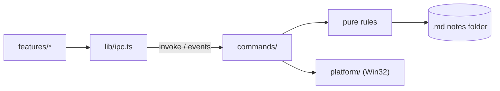

# Architecture

Current state and direction of the current stage. What does not yet exist is marked as _planned_.

## Structure

```text
src/                     UI (Svelte 5 + Vite)
  App.svelte             Screen composition, no business rules
  lib/ipc.ts             Only entry point that calls Rust
  lib/i18n.ts            Interface text in English and pt-BR, and error codes to text
  lib/features/<name>/   Components, state and tests for each feature
  lib/ui/                Generic visual components
  lib/styles/tokens.css  Colors, spacing and typography
src-tauri/src/           Backend (Rust)
  lib.rs                 Only assembles the app and registers modules
  panel.rs               Pure panel state machine
  dock.rs                Thread connecting cursor, state machine and windows
  tray.rs                Tray: screen side, exit and Windows startup
  main_window.rs         Creates the main window and limits its navigation
  shortcut.rs            Global panel shortcut
  web.rs                 Web page window, with untrusted content
  notes.rs               Folder, listing, safe reading and atomic saving of notes, leftovers, local images
  i18n.rs                Interface language, from the Windows display language
  error.rs               Errors sent to the UI as codes
  watch.rs               Tells the UI when the notes folder changes
  commands/              Tauri commands: thin delegating layer
  platform/              Operating-system-specific code
```

Create folders when the first feature needs them.

The tray chooses the screen side, exits the app and controls Windows startup; a second instance simply
exits.

## Flow



## Language

Rust reads the Windows display language once at startup: any Portuguese gets pt-BR, everything else
English. The tray uses it directly and `app_locale` hands it to the UI, which sets it before mounting;
changing the Windows language takes effect on the next start. Commands fail with `{ code, ...fields }`
(`error.rs`), and `i18n.ts` turns each code into text; `detail` carries the operating system's message,
already in its language. An unknown code shows as an unexpected error with its raw fields.

## Panel

M0 prototype. `panel.rs` is a pure state machine, without Win32 access:

```text
Hidden → Arming (cursor at edge, waiting) → Open → Pinned
Hidden → Summoned (by shortcut) → Dismissed (cursor still at edge) → Hidden
```

`dock.rs` connects it to the window on a single thread, which polls the cursor, receives UI requests and
animates. Thus opening, closing and animating do not compete. Coordinates are physical pixels, with
per-monitor DPI awareness (PMv2).

- **Side:** right by default, or left, chosen in the tray and saved in `settings.json`; a missing or
  unknown value means right. Everything below mirrors on the left. Switching moves the windows at once,
  without animation, keeping the panel open or closed.
- **Trigger:** cursor polling every 50 ms; the edge is the outer pixel column of the outermost monitor on
  the chosen side, the only one that holds the cursor, with a 150 ms pause. A thin window at the edge would steal clicks
  from scrollbars and maximized window buttons. Points outside that monitor are ignored.
- **Shortcut:** `Ctrl+Alt+Space`, registered by Rust, without permission in the capability. If registration
  fails, the failure is logged and the panel still opens by cursor. It opens immediately and focuses the
  panel; if opened by cursor, it closes; if pinned or the native picker is open, it does nothing. The
  picker is modal and would re-enable the hidden panel window.
- **Opened by shortcut:** focus governs, not the cursor. It closes via the shortcut, Esc with the panel in
  the foreground and no field being edited, or when focus moves to another app. A focused page counts as
  panel focus, and the native picker keeps it open. Null focus, common during system transitions, is
  ignored. After closing this way, the edge only takes effect again once the cursor leaves it.
- **Shortcut activation:** the key gives the process the right to use `SetForegroundWindow`, provided the
  window is already enabled. If activation fails, with no focus to lose, the panel follows the cursor rule
  and does not get stuck over other windows.
- **Esc:** each press counts once. The press that leaves a field or closes the picker has already been
  handled and does not also close the panel, even if the UI reports it before the next poll.
- **Expansion:** the window already exists at its final size, parked just beyond the edge, and slides with
  `SetWindowPos`, without resizing the WebView. Each frame waits for `DwmFlush` and position follows real
  time, targeting 150 ms.
- **Neighboring monitor:** the parked position is outside all screens, because there is no monitor beyond
  the chosen one on that side. The window region is still clipped to the monitor's columns each frame;
  when parked, it is empty.
- **Focus:** the window uses `WS_EX_NOACTIVATE` and `WS_EX_TOOLWINDOW` and opens without activation by
  cursor. UI `pointerdown` requests activation. At each cursor poll, the panel remembers the last foreground
  app outside itself and the native picker; on close, focus returns to that app unless the user is already
  in another. If it no longer exists, focus goes to the desktop.
- **Web page:** its own window (`web.rs`), owned by the panel, below the top bar. The panel thread positions
  and moves it with `DeferWindowPos`, in the same transaction as the main window. No `WS_EX_NOACTIVATE`,
  because the page does not talk to Rust: Windows activates the window on click. It is outside the `main`
  capability, Tauri rejects remote-origin commands and `lib.rs` accepts commands only from the `main`
  window; `__TAURI_INTERNALS__` exists on the page, but `invoke` fails. It navigates only over http(s),
  outside Tauri's `*.localhost` origins, and never opens another window: `target=_blank` and `window.open`
  navigate in the page window itself.
- **Focused page:** keeps the panel open, like editing in the UI. With the cursor outside, Esc returns focus
  to the previous app and the panel closes; with the cursor over it, Esc belongs to the page. Since the page
  does not talk to Rust, the key is read during cursor polling.
- **Hidden panel:** the window is disabled. `WS_EX_NOACTIVATE` alone is not enough: when the foreground app
  closed, Windows activated the off-screen panel and the keyboard went to an invisible window.
- **Collapsed panel (_planned_):** WebView2 reduces memory use while hidden.
- **Monitor changes:** at each cursor poll, the panel re-reads the monitors. If layout, resolution, DPI or
  taskbar changes the chosen monitor, the windows move to the new position without animation.

## Notes

`notes.rs` stores the chosen folder and the screen side in `settings.json`, in the app configuration, and lists `.md` files
recursively, excluding hidden folders, symlinks and junctions. Opening validates the path and checks that the
canonical target is inside the folder. The native picker keeps the panel open. Rust converts and sanitizes
markdown before sending it to the UI, which has no filesystem permission. A closed YAML frontmatter block
at the start is hidden; title and tag scalars, flow lists and block lists are extracted as plain text.
The small parser ignores unsupported YAML; an unquoted `#` after whitespace starts a comment, while
quoted `#` and `a#b` are literal. The raw text remains unchanged.

**Saving.** `notes_open` returns the sanitized HTML, the raw text and a version: a hash of the file's bytes,
opaque to the UI and valid only within one run. `notes_save(path, content, base)` validates the path like
opening, writes only if the file still has version `base` and returns the new version; otherwise it
answers `conflict` and writes nothing. Content equal to the file counts as saved without writing. Text
goes to disk exactly as received, without touching line endings. Saves are serialized in Rust, and the
check is confirmed against the version actually replaced, so an external write that slips in is never
overwritten.

**Atomic writes.** Each write creates its files next to the target with unique names,
`<name>.<pid>-<n>.docdock-tmp` and `.docdock-bak`; the extension is not `.md`, so listing ignores
leftovers, and a write never deletes a file it did not create. `settings.json` is written to a synced
temporary file and renamed over the original; folder and side updates run load, change and save under one
lock. A note goes through `ReplaceFileW`, which keeps the file's identity, ACL and creation time and moves
the replaced file to the backup name. The backup is then opened without sharing: if it is still the base
version (or our text), it is deleted through that handle and the save succeeds. Otherwise, or if another
app still has it open, an external write slipped in: two renames put it back at the note, which works
while the other app holds it, our copy is deleted only if it still matches the text the editor keeps, and
the answer is `conflict`. When `ReplaceFileW` fails, the note keeps its name, or it is renamed back from
the backup (`ERROR_UNABLE_TO_MOVE_REPLACEMENT_2`). Any version that cannot be put back stays on disk and
the error names it. A file another app holds open without delete sharing cannot be replaced, and the save
fails.

**Autosave.** `features/notes/autosave.ts` saves the whole text after a pause in edits, with one save in
flight and the latest edit queued. `flush` saves at once and waits; on a conflict it stops saving and keeps
the edit in `unsaved()`, and after an error the next edit or `flush` retries. `stop` drops unsaved text and
ignores later edits; the editor calls it only when the user discards edits that keep failing to save, such
as for a note deleted outside the app.

**Editor.** Reading is the default: sanitized HTML from Rust. The pencil toggle or a double-click
opens `features/notes/Editor.svelte` with the whole raw text, including frontmatter. CodeMirror 6
parses GFM; `live-formatting.ts` decorates visible ranges on document, selection, parser and viewport
changes. Headings, emphasis, strikethrough, quotes, lists, rules, tasks, code and local images hide
syntax outside selection lines. Tables remain raw. Multiline image syntax is replaced one line at a time. Task checkboxes make
one undoable text transaction and respect read-only state. Image widgets use the same decoding,
traversal and segment encoding rules as Rust `image_url`; they never insert HTML. A StateField supplies
the block frontmatter replacement (title and tags); clicking or keyboard-activating it reveals the
framed raw block. Metadata is cached by immutable document identity. Raw text is tracked separately
from CodeMirror offsets so untouched CRLF, LF and CR
line endings, including mixed files, survive edits; new lines use the first existing separator (LF in
an empty file). No Markdown serialization occurs.

Each editor owns an autosave instance. Blur flushes; Esc, the toggle, opening another note and choosing
a folder flush and refuse to leave on conflict or error. Leaving temporarily makes the editor read-only,
flushes and rereads sanitized HTML from disk. Esc blurs synchronously, like TextField, so the panel
consumes that press. Focus reports editing to the panel. Conflicts keep the text and stop saving;
Keep my version rereads the disk version and saves the latest editor text against it (another race
can conflict again). Discard my changes explicitly replaces the text from disk. Errors stay near
the editor. A clean external reload resets autosave and keeps the cursor clamped to the new length;
pending or in-flight text is never replaced. An editor revision rejects reads started before an edit,
save completion or another reload.

**Pasted images.** Text in the clipboard takes precedence. Otherwise the editor sends the file as a
raw IPC body with a percent-encoded note path header. Rust validates the note with `resolve`, accepts
only PNG, JPEG, GIF and WebP magic signatures, and limits attachments to 10 MiB to bound disk use and
accidental large clipboard writes. It creates `attachments/pasted-YYYYMMDD-HHMMSS.<ext>` beside the note,
using local time and `-2`, `-3` suffixes for collisions. A synced temporary file becomes the final file
through `move_new`, never replacing an existing file. The attachment directory cannot be a reparse
point; open directory handles prevent replacement of it and its canonical ancestors during the write.
Note aliases with a different canonical parent are refused so the relative link remains correct.
The editor is read-only while the paste is pending, preserves the insertion selection, and waits for
it before leaving. Reloads are refused during that wait; insertion then creates an ordinary unsaved
Markdown edit protected by autosave's existing watcher guard. Errors use the existing editor notice.
The reading view resolves the inserted link through `markdown::image_url` and `note-asset`.

CodeMirror lives in an open ShadowRoot. In style-mod 4.1.4, only a root without `head` uses
`CSSStyleSheet` and `adoptedStyleSheets`; mounting directly in Document would inject a blocked style
tag. External CSS links load `content.css` (also imported by the reading view) and editor chrome inside
the shadow, with `:host` specificity above CodeMirror base styles. Chromium headless verified the production Vite output with the exact CSP header
from tauri.conf.json: one adopted sheet, zero runtime style tags, no CSP violations, and editor
creation, edits, conflict resolution and reloads after freezing Object.prototype before app startup.
WebView2 and native panel focus/Esc still require manual verification.

**External changes.** Listing a folder starts watching it (`watch.rs`, with `notify`); choosing a folder
stops the watch, so the next listing starts a fresh one even for the same path. Events are grouped until
200 ms of quiet, at most 1 s, and become one `notes-changed` event to the `main` window. Changes inside
hidden folders and to temporary or backup files of a save do not count; lost events do. The UI then
rereads the folder, the list and the open note, replacing the note only if its version changed; a read
that started before choosing a folder or opening a note is dropped and redone. A note
that disappeared keeps its last content on screen with a notice. While editing, only a clean editor
accepts the new text, as described above; saving compares the loaded disk version before writing.

**Leftovers.** A save that stops between its two renames, for example when the app closes, leaves
`.docdock-bak` files and may leave the note name empty. Opening a folder lists every
`<note>.md.<pid>-<n>.docdock-bak` outside hidden folders, under the save lock so a save in progress is not
mistaken for one. Restoring renames the backup to the note name, or to `<stem> (recovered).md`,
`(recovered 2)` and so on (pt-BR: `recuperada`) if the name is taken. Nothing is overwritten or deleted;
the user compares the copies and removes the extra one.

## Untrusted content

Decisions in [0004](decisions/0004-untrusted-content.md).

- **CSP:** in `tauri.conf.json`, applies only in the production build. In dev, the page comes directly from Vite, without CSP.
- **`main` window:** `main_window.rs` creates it, navigates only within the UI origin and opens no other window. Links in rendered content do not navigate away from it.
- **GitHub alerts:** pulldown-cmark GFM emits typed blockquotes. Ammonia retains only the five
  `markdown-alert-{note,tip,important,warning,caution}` classes on blockquotes. Shared CSS supplies
  literal English kind titles; the editor uses text widgets and line decorations for the same kinds.
- **Local images:** `http://note-asset.localhost/<relative path>`, served by `notes.rs` only to the `main` window. Remote images are blocked.
