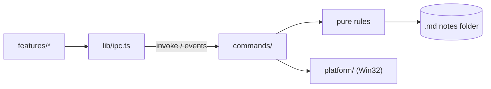

# Architecture

Current state and direction of the current stage. What does not yet exist is marked as _planned_.

## Structure

```text
src/                     UI (Svelte 5 + Vite)
  App.svelte             Screen composition, no business rules
  lib/ipc.ts             Only entry point that calls Rust
  lib/i18n.ts            Interface text in English and pt-BR, and error codes to text
  lib/clipboard.ts       Copy and cut kept out of clipboard history and cloud clipboard
  lib/features/<name>/   Components, state and tests for each feature
  lib/ui/                Generic visual components
  lib/styles/tokens.css  Colors, spacing and typography
src-tauri/src/           Backend (Rust)
  lib.rs                 Only assembles the app and registers modules
  panel.rs               Pure panel state machine
  dock.rs                Thread connecting cursor, state machine and windows
  tray.rs                Tray: screen side, exit and Windows startup
  main_window.rs         Creates the main window and limits its navigation
  shortcut.rs            Global panel shortcut
  web.rs                 Web page window, with untrusted content
  notes.rs               Folder, listing, safe reading and atomic saving of notes, leftovers, local images,
                         renaming, moving, folders, deleting with undo, reading and editing `_pinned.md`
  pinned.rs              Pure line rules for `_pinned.md`: parse, pin, unpin, repin, move, rename
  trash.rs               The notes folder's own 30-day trash for deletes without a Recycle Bin
  i18n.rs                Interface language, from the Windows display language
  error.rs               Errors sent to the UI as codes
  watch.rs               Tells the UI when the notes folder changes, leaves or returns
  commands/              Tauri commands: thin delegating layer
  platform/              Operating-system-specific code
```

Create folders when the first feature needs them.

Preferences and the tray share the screen-side operation in `tray.rs`: save through the existing
locked atomic settings update, update both tray check marks, and request the panel move. The
`panel-focus` report synchronizes the Preferences radios, including changes from the tray. A failed
save still moves for this session, with an error reported to the caller. No settings format changed.
Preferences keeps Notes mounted but hidden and suspends its keyboard handling; the page window is
hidden through the same operation used by the Notes tab. Formatting shortcut descriptions live with
the editor bindings.

The tray also exits the app and controls Windows startup; a second instance simply
exits. Startup is the `DocDock` value in the current user's `Run` key, written by
`platform/autostart.rs` with the executable path quoted, so a path with spaces can neither break nor
start `C:\Program.exe`. Preferences > General and the tray share the operation in `tray.rs`, which
rereads the registry after a change, updates the tray check and emits `autostart-changed` to the main
window. Preferences subscribes before its initial read and removes the listener on leaving; startup
is never duplicated in `settings.json`. Turning it on or off from either control clears Task Manager's choice in
`StartupApproved\Run`; a choice made later in Task Manager is respected. At startup, an entry left
unquoted by older builds, or naming an executable that no longer exists, is pointed at the running
one; an entry for another existing copy is left alone.

## Flow



## Distribution and updates

NSIS installs for the current Windows user, in English or pt-BR, with a WebView2 bootstrapper when
needed. Installers have no Windows code signature; see `decisions/0008-distribution.md` for the
accepted SmartScreen warning and release-channel policy. The manual release workflow creates
a GitHub release draft with signed updater artifacts and `latest.json`.

`updates.rs` checks once at production startup, downloads and verifies in Rust, and enables a tray
restart action. Neither webview has updater permissions. Quit and update share a native exit gate:
an event asks the main UI to freeze input and finish the editor through its existing save guard;
only its matching acknowledgement allows exit or installation. Busy content operations, save errors
and conflicts keep the process open. Failed installation restores input and reports a native dialog;
the next launch retries the download. Windows NSIS relaunches without a process plugin.

## Language

Rust reads the Windows display language once at startup: any Portuguese gets pt-BR, everything else
English. The tray uses it directly and `app_locale` hands it to the UI, which sets it before mounting;
changing the Windows language takes effect on the next start. Commands fail with `{ code, ...fields }`
(`error.rs`), and `i18n.ts` turns each code into text; `detail` carries the operating system's message,
already in its language. An unknown code shows as an unexpected error with its raw fields.

## Panel

**Capture exclusion.** The panel and its owned web page window always request capture exclusion
through `platform/capture.rs`: `SetWindowDisplayAffinity` targets each top-level Tauri HWND, which
covers its WebView2 children and the app's DOM-rendered menus. It runs after creation while the window
is still hidden, before note or page content is shown, including every recreation of the page window.
`WDA_EXCLUDEFROMCAPTURE` is tried first; Windows before 10 2004 refuses it and gets `WDA_MONITOR`, a
black window in captures. This is best effort: failures are only logged, and only capture APIs that
honor display affinity respect it. There is no preference, so the user's own screenshots of the panel
are blank too. System folder pickers and update dialogs show no note content and are left alone; new
browser windows are denied. Known gap: Chromium-native popups, such as the default context menu (which
can show selected text in "Search the web for") and page `<select>` lists, are separate windows in the
WebView2 process that the app's affinity does not reach.

`panel.rs` is a pure state machine, without Win32 access:

```text
Hidden → Arming (cursor at edge, waiting) → Open → Pinned
Open → Summoned (a click gives the panel or its page focus, or the shortcut)
Hidden → Summoned (by shortcut) → Dismissed (cursor still at edge) → Hidden
```

`dock.rs` connects it to the window on a single thread, which polls the cursor, receives UI requests and
animates. Thus opening, closing and animating do not compete. Coordinates are physical pixels, with
per-monitor DPI awareness (PMv2).

- **Side:** right by default, or left, chosen in Preferences or the tray and saved in `settings.json`; a missing or
  unknown value means right. Everything below mirrors on the left. Switching moves the windows at once,
  without animation, keeping the panel open or closed.
- **Width:** 460 logical pixels by default, dragged from the inner edge (or arrows on the focused
  handle) and saved as `width` in `settings.json` when the drag ends; a missing or invalid value
  means the default. `dock.rs` clamps it to at least 320 and at most half the monitor's work area,
  so a width saved on a large monitor never covers most of a smaller one. While dragging, the panel
  stays open as if a dialog held it. The page window starts 4 logical pixels in from the inner
  edge, so with its 2-pixel region inset a 6-pixel strip of the UI, where the handle sits, runs the
  full height; windows slide at the panel's `x`, each with its own horizontal offset.
- **Trigger:** cursor polling every 50 ms; the edge is the outer pixel column of the outermost monitor on
  the chosen side, the only one that holds the cursor, with a 150 ms pause. A thin window at the edge would steal clicks
  from scrollbars and maximized window buttons. Points outside that monitor are ignored.
- **Shortcut:** `Ctrl+Alt+Space` by default, registered by Rust, without permission in the capability.
  The UI sends the modifiers and the physical `KeyboardEvent.code` through `shortcut_set`. Registration
  uses virtual keys, which follow the layout, so `shortcut.rs` first maps a letter, digit or punctuation
  position to the layout's virtual key (`platform/keyboard.rs`, `MapVirtualKeyEx`): AZERTY's `KeyQ`
  becomes A, and a position whose virtual key is not a letter or digit is unsupported. Validation is a
  pure function on the result (Ctrl, Alt or Win required; Ctrl+Alt with a letter or digit refused as
  AltGr; otherwise only F1–F24, arrows, Space and navigation keys). A small state machine behind a
  `Hotkeys` seam follows: recording unregisters the current combination so the panel receives it, a
  new one replaces it only once registered, and otherwise the previous one is registered again. Rust
  guarantees a recording ends: the panel thread ends it when the panel loses foreground or hides, a
  30-second timer ends that recording if still running, and a (re)loaded UI ends any by reading the
  state with `shortcut_record(false)`. Recording state is touched only on the main thread, where
  hotkeys register, and an ending the UI did not ask for is emitted as `activation`. The
  shown form, such as `Ctrl+Shift+K`, is saved as `activation_shortcut` in `settings.json`. A saved
  combination that fails at startup falls back to the default for the session, keeps the saved value
  and is reported as `failed` for a notice; if the default also fails, the panel still opens by cursor.
  The machine never closes on it: hidden,
  opened by cursor or summoned, the panel opens at once if needed, takes focus and becomes summoned; pinned,
  it takes focus and stays pinned. Rust then emits `panel-search` with `toggle`, whether the panel window
  was already foreground before the press. The UI focuses the search bar and selects its text, or, with
  `toggle` and the bar already focused, asks to close (`panel_close`); a pinned panel stays shown and only
  returns focus to the previous app, like Esc in its search bar.
  Deciding in the UI avoids mirroring the bar's focus in Rust; reading `toggle` before activating keeps a
  bar that kept DOM focus in a hidden or hover-opened panel from counting. With the native picker open,
  it does nothing: the picker is modal and would re-enable the hidden panel window.
- **Summoned (focus governs):** by the shortcut, or once a cursor-opened panel or its page becomes
  foreground (a click). Focus governs, not the cursor. It closes when the UI asks (`panel_close`: Esc in
  the search bar, or the shortcut there) or when focus moves to another app. A focused page counts as
  panel focus, and the native picker keeps it open. Null focus, common during system transitions, is
  ignored. After closing this way, the edge only takes effect again once the cursor leaves it. Without
  focus (hover only), the panel never takes it and closes when the cursor leaves.
- **Pinned:** neither the cursor nor focus closes it. A close request from the UI returns focus to the
  previous app, as closing does, but the panel stays shown; the previous app is the last foreground window
  outside the panel, tracked at each poll. Being foreground, the panel may hand focus over.
- **Shortcut activation:** the key gives the process the right to use `SetForegroundWindow`, provided the
  window is already enabled. If activation fails, with no focus to lose, the panel follows the cursor rule
  and does not get stuck over other windows.
- **Esc:** in the panel window the UI owns it, layer by layer (see "Note list"), and only the last layer
  asks Rust to close, so no press both leaves a field and closes the panel. Rust reads the key only for
  a focused page, which does not talk to Rust, and counts each press once.
- **Focus band:** at each poll, Rust emits `panel-focus` (`focused`, `side`) when it changes: focused while
  the panel window or its page is foreground; null focus keeps the last report. The UI draws a 2 px accent
  band on the inner edge. DOM focus events cannot see the page window, a separate window, so polling is
  the source. The page window covers the band below the top bars.
- **Expansion:** the window already exists at its final size, parked just beyond the edge, and slides with
  `SetWindowPos`, without resizing the WebView. Each frame waits for `DwmFlush` and position follows real
  time, targeting 150 ms.
- **Neighboring monitor:** the parked position is outside all screens, because there is no monitor beyond
  the chosen one on that side. The window region is still clipped to the monitor's columns each frame;
  when parked, it is empty.
- **Focus:** the window uses `WS_EX_NOACTIVATE` and `WS_EX_TOOLWINDOW` and opens without activation by
  cursor. UI `pointerdown` requests activation, which makes the panel summoned at the next poll. At each cursor poll, the panel remembers the last foreground
  app outside itself and the native picker; on close, focus returns to that app unless the user is already
  in another. If it no longer exists or is minimized, focus goes to the desktop.
- **Web page:** its own window (`web.rs`), owned by the panel, below the header and unified bar. The panel thread positions
  and moves it with `DeferWindowPos`, in the same transaction as the main window. No `WS_EX_NOACTIVATE`,
  because the page does not talk to Rust: Windows activates the window on click. It is outside the `main`
  capability, Tauri rejects remote-origin commands and `lib.rs` accepts commands only from the `main`
  window; `__TAURI_INTERNALS__` exists on the page, but `invoke` fails. It navigates only over http(s),
  outside Tauri's `*.localhost` origins, and never opens another window: `target=_blank` and `window.open`
  navigate in the page window itself. `on_navigation` sees only the main frame, so `platform/guard.rs`
  cancels iframe navigations to Tauri's origins and every external scheme launch from any frame; the
  window is created blank and navigates only once the guard and the navigation observers are
  installed. Tauri registers the window before that, so one lock covers the whole open: a concurrent
  open waits instead of navigating the unguarded window, and a window whose setup failed is never
  navigated.
- **Browser mode:** a shown page replaces the note list. Notes hides and disables its native window,
  retaining its document and history; the Browser tab restores it at the current panel position. The tab can also show an empty state
  before a native page exists. Both tabs share the search field and a contextual "+" action.
  Hidden pages are excluded from positioning, sliding, activation and focus tracking. Closing the panel
  disables the shown page too. Back/forward use WebView2's history, guarded by native availability.
  `platform/browser.rs` observes SourceChanged, DocumentTitleChanged and HistoryChanged on the WebView2
  UI thread and emits `web-state` (URL, title, back/forward availability) to main. The page sends no
  messages to Rust. The panel thread emits `web-visible` after switching visibility. UI metadata is text.
  The unified bar shows the current URL, with a separate draft while typing. `suggestions.ts` supplies
  pure intent, entries and default selection rules; notes, Create and web actions share arrow/Enter
  selection. Notes queries stay local; choosing Search the web enters `?` mode. URL-like text offers
  Open explicitly; only an http(s) prefix makes Open the default over notes/Create.
  In browser or `?` mode, Rust queries DuckDuckGo after a short debounce (minimum two characters).
  A generation discards stale responses, including A → B → A. `ureq` uses a two-second timeout, no
  cookies/referer or redirects; JSON is capped at 32 KiB, eight unique phrases of 200 characters,
  without controls. Failures silently leave local entries. Text is rendered as text; CSP is unchanged.
  `search_engine` in settings.json defaults to `duckduckgo` (the supported engine), without settings UI.
  SourceChanged records actual http(s) visits, not submitted input, through a serialized atomic update
  of `address-history.json` in app_config_dir. Most recent first, deduplicated, 300 entries; corrupt
  history starts empty. Matching addresses precede engine phrases. The primary Open/Search action
  remains first for Enter. Browser suggestions float over the page. `web_overlay` sends their measured height to the panel
  thread; `platform/windows.rs` combines a top cutout with monitor clipping and a two-logical-pixel
  side/bottom inset using `SetWindowRgn`. Bounds and viewport never change for suggestions. The stored
  cutouts are reapplied during every slide frame and DPI relocation; Windows owns successful regions.
  Esc or moving focus to the page dismisses the dropdown and removes only its top cutout.
- **Mobile pages:** all sites in `web` receive a mobile Android identity. Before its first real
  navigation, `platform/browser.rs` reads WebView2's default `Settings2.UserAgent`, replaces the
  Windows platform with `Linux; Android 10; K`, inserts `Mobile` and changes `Edg/` to `EdgA/`,
  retaining the installed engine versions. Setting the UA alone left Windows Client Hints on
  WebView2 156, so `Emulation.setUserAgentOverride` also supplies Android/mobile metadata; omitted
  brand/version lists retain the runtime's values. Setup waits for CDP acknowledgement (five-second
  limit), and destroys the blank window on failure, just as for guard/observer installation.
  The target keeps the override across navigation, reload and renderer replacement (verified after
  a deliberate renderer crash); a new window installs it again. Real-app checks on DuckDuckGo,
  GitHub, English Wikipedia and Google Search showed mobile layouts, `Sec-CH-UA-Mobile: ?1`,
  `Sec-CH-UA-Platform: "Android"` and matching `navigator.userAgentData`. Legacy `navigator.platform`
  still reports `Win32`. No touch or viewport emulation is enabled; hardware capabilities remain
  native. `main` keeps its default identity, and the suggestions HTTP client is unchanged.
- **Edge features:** `platform/edge.rs` filters WebView2's accelerator keys and context menu in both
  windows, installed natively before the first navigation, so no script or channel is involved.
  Edge's dialogs and popups (downloads, history, print, save, view source, DevTools, find) either
  cannot be closed in the panel or take focus from it, which closes the panel; the find bar is a
  separate popup window. Keys outside an allowlist lose their browser action
  (`IsBrowserAcceleratorKeyEnabled = false`) but still reach the content as key events, so the
  editor gets Ctrl+J. The page keeps reload, zoom and back/forward; the UI keeps none, except
  DevTools in debug builds. Ctrl+Tab on the page is consumed natively and emitted to `main` as
  `panel-toggle-mode`; the page never sees it. Context menus keep only editing items, plus
  back/forward/reload on the page; unknown or future items are dropped. The UI's menu also drops Copy
  link and Copy image, which bypass the copy event (see "Copy and cut" in Notes).
- **Page selection:** `web_selection` returns the native URL, the page title and its selected text,
  or null without an http(s) page. `platform/browser.rs` evaluates one constant expression,
  `[document.title, getSelection().toString()]` sliced to 4,096 and 20,000 UTF-16 units and made
  well-formed, through WebView2's DevTools protocol: `Target.getTargetInfo` (the page target id is
  the main frame id), `Page.createIsolatedWorld` (world `docdock`, reused per document), then
  `Runtime.enable` only to receive that world's `executionContextCreated` with its `uniqueId`,
  `Runtime.disable`, and `Runtime.evaluate` with `uniqueContextId`. A numeric context id may name
  another context, even the page's own world, after a cross-process navigation; a `uniqueId` names
  one context of one document, so evaluation never lands elsewhere. Exactly one isolated `docdock`
  context of the main frame with the returned id must match, with a `uniqueId`, or nothing is
  evaluated. While enabled, `Runtime` serializes the page's console calls, so a page can notice a read
  happening, but nothing more. The isolated world shares the DOM but not the page's globals or
  prototypes, so the page cannot replace `getSelection`, `slice` or `toWellFormed` there, and the
  response stays under about 150 KB. The one-shot completion handlers are the only receivers; the
  page cannot call or observe the world. Handlers run on the WebView2 UI thread and send over a
  channel that the async command waits on in a blocking-pool thread (`spawn_blocking`), for two
  seconds at most, so concurrent calls against a hung page hold no async runtime worker; the page
  stays frozen itself (navigating away waits on its renderer) while the panel keeps working.
  Navigation identity changes on `NavigationStarting` and on commit (`ContentLoading`); a navigation
  is in flight until it commits or `NavigationCompleted` reports it, and a commit settles older ones.
  Nothing is evaluated while one is in flight, since its document may commit mid-read before the UI
  thread hears of it, and the result counts only if the identity and URL are unchanged before and
  after evaluation, so a same-URL reload or A → B → A discards it. The title comes from the same
  evaluation because WebView2's native title can still be the previous document's after the next
  one commits; without a result, title and selection are empty. Reads take turns, because a
  `Runtime.enable` lists contexts only once while the domain is on, and the event handler and the
  domain are released whether `Runtime.enable` succeeds or fails. The response
  is still untrusted: only an array of two strings up to 256 KiB is accepted; the title loses
  controls, the selection's line endings become LF and controls other than newline and tab are
  removed; both are trimmed and cut at their limits. Selections inside iframes are not read. Native
  URL and title are bounded by Chromium (2 MB URLs, 4,096-character titles), also in the
  `Target.getTargetInfo` response.
- **Focused page:** counts as panel focus, so the panel is summoned. With the cursor outside, Esc returns focus
  to the previous app and the panel closes; with the cursor over it, Esc belongs to the page. Since the page
  does not talk to Rust, the key is read during cursor polling.
- **Hidden panel:** the window is disabled. `WS_EX_NOACTIVATE` alone is not enough: when the foreground app
  closed, Windows activated the off-screen panel and the keyboard went to an invisible window. When the slide
  out ends, `dock.rs` emits `panel-hidden` to the UI (the page's `visibilitychange` does not fire for a
  window moved off-screen). The UI then blurs its focused element: WebView2 keeps its inner focus after the
  foreground moves away, so a hover-opened panel would otherwise show a focused bar without focus.
- **Collapsed panel (_planned_):** WebView2 reduces memory use while hidden.
- **Monitor changes:** at each cursor poll, the panel re-reads the monitors. If layout, resolution, DPI or
  taskbar changes the chosen monitor, the windows move to the new position without animation.

## Notes

`notes.rs` stores the chosen folder and the screen side in `settings.json`, in the app configuration, and lists `.md` files
recursively, excluding hidden folders, symlinks and junctions. Opening validates the path and checks that the
canonical target is inside the folder. The native picker keeps the panel open. Rust sends the raw text to the UI,
which has no filesystem permission. A closed YAML frontmatter block at the start is hidden; title,
http(s) url and tag scalars, flow lists and block lists are extracted as plain text by
`features/notes/markdown.ts`.
The small parser ignores unsupported YAML; an unquoted `#` after whitespace starts a comment, while
quoted `#` and `a#b` are literal. Double-quoted scalars accept JSON escapes; single-quoted scalars
accept doubled apostrophes. The raw text remains unchanged.

**Search.** `features/notes/search.ts` keeps an in-memory index in the UI, a pure module without IPC.
`notes_list` carries each note's modified time (ms since the Unix epoch); `syncIndex` compares it with the
index and asks `notes_texts(paths)` only for new or changed notes, 200 at a time, then forgets removed
ones. `notes_texts` applies the `notes_open` path rules to each path and leaves out any note it cannot
read (missing, too large, not UTF-8, outside the folder) instead of failing the call; such a note stays
findable by name and is retried on the next sync. `FolderIndex` holds the current folder's index and runs
syncs one at a time; choosing a folder resets it to a new index, and a sync begun earlier fills only the
old one, so another folder's entries are neither shown nor reused. The caller syncs after each listing,
and the `notes-changed` reread is the trigger. Title and tags come from `markdown.ts`'s frontmatter parser
([0007](decisions/0007-one-markdown-parser.md)); the title falls back to the file name, and the body is
the text after the frontmatter. Matching ignores case and accents (per-character folding, so offsets
map back to the original text) and requires every word somewhere in title, tags or body, as substrings.
The pure `query.ts` parser separates free text and typed tag tokens with source ranges. Only standalone
`#tag` words are filters; JSON-quoted tags support spaces and quotes. Hashes inside words/URLs and
heading markers remain text. Every filter must equal a frontmatter tag under the same case/accent
folding, and every free-text word must still match. Body hashtags are not metadata.
`queryCompletion` supplies a tag context with replacement range and prefix; `folderTags` derives
case/accent-deduplicated prefix suggestions from the current index, excluding root `_pinned.md`.
The Notes bar owns caret, selection, dismissal and focus effects; accepting replaces just that token.
No tag index is persisted. Listing/watcher sync and folder reset update both hits and suggestions.
Filter queries suppress automatic Create and web suggestions, which receive only the free text;
explicit creation uses only free text (untitled if empty) and seeds the `#tag` filters as frontmatter
tags, so the note stays in the filtered list; the editor opens such a note with the caret after them.
Tag completion ignores only its active token while open; all other filters still apply. Folder tag
suggestions use cached folded keys; the first 50 in alphabetical order are shown. Creation serializes
parsed tags with the existing YAML scalar writer, ignoring date tokens.

Date tokens extend the same `query.ts` parser and completion ranges. Pure `query-date.ts` takes an
explicit `now`, resolves presets and partial ISO ranges to local calendar boundaries, and uses an
exclusive upper bound after the entire final day/month/year. Invalid and reversed tokens are ignored.
The search index derives its filter date from valid frontmatter `created`, then `date`, else modified
time; the existing scalar parser handles single/double quotes. Full ISO timestamps preserve offsets;
date-only values use local midnight. This does not change date display, filesystem creation dates,
ordering or grouping. Searches refresh on the existing 30-second grouping clock.

Order: title equal to the query, title starting with it, a word in the title, a word in a tag, body only;
ties newest first. `search` also says whether a title equals the query (`exactTitle`, which decides
whether the UI offers "Create"), and gives each body match a short snippet of plain text with offsets for
highlighting, never HTML. An empty query lists every note by modified time. With 2000 notes of about
5 KB, building takes about 70–120 ms and a query a few ms; the full text index (FTS5) is not needed.

**Saving.** `notes_open` returns the raw text and a version: a hash of the file's bytes,
opaque to the UI and valid only within one run. `notes_save(path, content, base)` validates the path like
opening, writes only if the file still has version `base` and returns the new version; otherwise it
answers `conflict` and writes nothing. A missing note is recreated only on a save of an edit,
through a synced temporary file and `move_new`, which refuses replacement. Every parent component is
held against rename and checked for links; an unavailable parent is never created. An empty base token
explicitly expects absence: if another file took the deleted name, the save conflicts. Content equal to
the file counts as saved without writing. Text
goes to disk exactly as received, without touching line endings. Saves are serialized in Rust, and the
check is confirmed against the version actually replaced, so an external write that slips in is never
overwritten.

**Renaming.** `notes_rename(from, to, base, title)` moves a note to another name in the same folder
under the save lock, with its folders held, only if it still has version `base`; `move_new` refuses a
taken name, which fails with `renameConflict`, and allows a case-only change of the same file. Renaming
happens only while editing, from the title field or on leaving an untitled note; the editor stays open: `Editor.rename` first applies a new
frontmatter title as an edit of the text (`retitle`, one undo step), saves everything, then holds later
saves while the move runs, so none goes to the old name; once `moved` gives the editor the new path,
they continue there. Leaving the editor waits for a rename in progress. The UI picks the name as for a
new note (`renamedPath`) and tries the next free one on a conflict. Leaving the editor of an `Untitled` note (`isUntitled`) first renames
it the same way to `noteName`, read from the reading model; when that is the frontmatter title, the
title is kept and only the file follows. Pinned items of the note then point
at the new path, keeping a `#fragment` and the rest of their line; their link text follows only while
it is still the old title. If `_pinned.md` cannot follow, the answer is `pinnedNotRenamed` and the
rename stands. Links in other notes are not rewritten. The watcher reports the move as a rename, as for
an external one.

**Moving.** `notes_move(from, to, base)` shares rename's move (`relocate`): same lock, version check,
`move_new` without replacing, `renameConflict` on a taken or reserved name, collapsed state and pinned
items following, `pinnedNotRenamed` when the list cannot. It differs in that the target folder must be
another existing one, not hidden, held with its ancestry as named rather than canonicalized, so a link
at any level is refused, even one pointing inside the notes folder, and the name checked against
reservations and pinned items is the one written; and the pinned link text never changes. `notes_folders` lists the folders listing visits
(hidden ones and links skipped). `notes_create_folder` creates a `/`-nested folder level by level, each
parent held, keeping one that exists; a name Windows would not keep as typed (trailing dot or space,
`<>:"/\|?*`, control characters, device names such as `CON` or `com1.txt`), a hidden one or the root
`_pinned.md` answers `invalidFolderName`, and a file in the way of a level `folderNameTaken`. The UI (`MovePicker`) creates the folder first, then moves to
the note's own name there or the next free one (`movedPath`), retried on a conflict as a rename. An
edited note moves through `Editor.rename`, so the editor follows it and no save reaches the old path;
otherwise the note cannot open in the editor while it moves. After the move, `movedLinks` (pure, in
`features/notes/links.ts`, on `noteParser`) points the note's relative link and image destinations,
inline and in reference definitions, at the same files from the new folder; no file moves. Web, email,
`#` and absolute targets, targets leaving the notes folder, code, raw HTML and the frontmatter (also
after a byte order mark) stay, as does every other byte. Only the leading `..` segments and the folders
the note left change; the link's own segments keep their spelling, and added folder names are
percent-encoded where Markdown or a URL would read them otherwise. In the editor the rewrite is an edit
of the current text, saved by autosave at the new path, and the move is registered as a rename, so
leaving the editor waits for it; otherwise it goes through `notes_rewrite`, a save with the version
just read that never recreates a missing note, so a change, deletion or rename made meanwhile wins
and the links stay (`move.linksKept`). Renames stay in their folder and need no rewrite.

**Deleting folders.** `notes_delete_folder(path)` deletes at once, without asking. It validates a
non-root, non-hidden, non-internal relative folder with `hold_folder`, refusing junctions and symlinks
at every level and short-name aliases. Under the save lock, no entries means non-recursive
`remove_dir`; a concurrent new entry makes that fail safely and the folder then goes whole, like one
with content, to the Recycle Bin, or to the notes folder's own trash where the Recycle Bin cannot take
it (below). Parent handles remain held while deletion runs; the target handle is released to permit
deletion. Pins within that path are removed with the existing conflict-aware pinned helpers; failures
report `pinnedNotRemoved`. Note Undo copies inside the folder are discarded. A folder sent to the
Recycle Bin has no Undo in the app; one sent to the trash does, as any trash item. The UI leaves an
affected editor through its save guard before deleting, cancels pending opens, and blocks new opens
while deletion runs. Folder labels also include empty folders, using `notes_folders` on
listing/reload; moves and note deletes never remove their empty parents.

**Deleting.** `notes_delete(path)` deletes a note at once, without asking, under the save lock, with its
folders held, and answers a `Removal`: `undo` for a Recycle Bin Undo, `trash` for the trash entry.
`platform/recycle.rs` uses the shell's `IFileOperation` on a thread of its own; its progress sink
cancels the delete when `PreDeleteItem` lacks `TSF_DELETE_RECYCLE_IF_POSSIBLE`, so where the shell would
delete for good (no Recycle Bin on the volume, as on a network share, a file over the bin's limit or a
bin set to remove files at once) the note stays and recycling answers `Unsupported`; the shell also
cannot parse a vault path mounted by WinFsp, which answers the same. The note then goes to the trash.
Without the sink, `FOF_ALLOWUNDO` with `FOF_NO_UI` (which includes `FOF_NOCONFIRMATION`) deletes such a
file for good without asking, verified on a Cryptomator vault mounted through WinFsp.
`SHQueryRecycleBinW` is not used to decide: it says nothing about the bin's size limit or the "remove
files immediately" setting, and the sink sees the shell's own decision for each item. The sink also
reports where the file landed in the Recycle Bin; its bytes are read from there, so Undo keeps exactly
what was recycled even if another app swapped the path, and kept in memory with the path until the
panel hides (`forget_deleted`, from `dock.rs`). Hides count as sessions: a delete that ends after one
keeps nothing and answers that Undo is not possible. Meanwhile the path is reserved: saves and renames
to it answer a conflict, so a late save of an editor cannot recreate the note and a new note takes the
next name. Undo (`notes_undo_delete`) writes the copy back with the empty-base recreation, never over
a file that took the name (`restoreTaken`, Undo stays available); the Recycle Bin keeps its own copy.
Restoring from the Recycle Bin itself was not used: finding the item depends on the bin's internal
layout. A note over 2 MB is refused where the Recycle Bin would take it, since it is too large for
that copy: `platform::recyclable` asks the shell first, cancelling the operation before its first item,
and a note the bin would refuse goes to the trash, which needs no copy. Pinned
items are removed after the move (`pinnedNotRemoved` if they cannot be, the delete stands); Undo puts
back the exact previous `_pinned.md` if it did not change since, else pins the items again at the end
(`pinned::repin`), and leaves a deleted `_pinned.md` to its own restore. The UI leaves the note's
editor first, the guarded way, so its text is saved and nothing writes after the delete; a conflict
there stops the delete. While the delete runs, the note cannot open in the editor and an open already
in flight is dropped.

**The notes folder's own trash.** Where the Recycle Bin cannot take an item, `trash.rs` moves it with
`move_new` into `.docdock/trash` inside the notes folder, a rename on the same volume, so nothing
leaves the folder or the vault and the move is whole or not at all. Ordinary folders keep using the
Recycle Bin. Each item is one entry, a folder named `<deleted>-<n>-<random>-<depth>` in lowercase
base36: the deletion time in ms, a counter, a random value against collisions between computers syncing
one folder, and how many folders lie above the item. The entry holds the item at its original relative
path (`a/b/note.md` becomes `<entry>/a/b/note.md`), so the date and the path need no index file and
the original name is never cut. A path nested deeper than 128 folders is refused and the item stays
where it was. Listing (`notes_trash`, newest first) walks the entries: each level holds one real
folder, then one file or folder, ignoring files beside the chain and shell or sync noise
(`desktop.ini`, `Thumbs.db`, `.DS_Store`). An entry whose item cannot be told that way (two
candidates, such as after a sync conflict, a link, or a name that is not Unicode) is still listed,
without a path, so it can be seen and emptied, but not restored from the app. Restoring
(`notes_trash_restore(id, undo)`) refuses an internal path, `_pinned.md`, a file that is not a note,
and a final name Windows would not keep as written (a device name such as `con.md`, a trailing dot
or space); it moves the item back under the save lock, creating only the missing parent folders, each
under the folder creation rules, while existing ones are used as they are, holding both sides, and
takes a free name such as
`name (2).md` or `folder (2)` rather than overwrite (a name a Recycle Bin Undo reserves counts as
taken); the emptied entry folders are then removed without recursion. With `undo`, from the delete
notice, it also puts back the pinned items the delete removed, when the item returns under its own
name. Those are kept in memory only while the folder stays available: when it goes away, such as a
vault locking, `forget_unavailable` drops them with everything else derived from notes, and the item
then comes back without its pinned items; from Preferences it does not. The notice's Undo works beyond the
panel session for as long as the entry exists, and `trashItemMissing` answers once it does not (restored,
emptied or purged, perhaps on another computer). The command also tells the UI that the folder
changed, as the watcher would.

Items stay 30 days (`trash::KEEP_MS`; exactly 30 days still stays, and a time ahead of the clock is
not old) from the later of their deletion time, by the deleting computer's clock, and their entry
folder's last change, by this computer's, from when it was made or synced here; so a computer whose
clock ran late cannot have its entries purged early elsewhere. Then the purge removes them: at startup, on choosing a folder and when
the panel hides (`purge_trash`), on a thread of its own, only in the folder that `root` accepts by its
marker, so never while it is unavailable. "Empty trash" in Preferences (`notes_trash_empty(ids)`)
removes the entries that were listed and confirmed, not one synced in since. Listing failures that
are not a link tell the folder is unavailable, as while a vault locks. Every walk inside the trash (listing, restoring, emptying, purging) holds each folder, without following links, before reading it and until done with it, and every folder the trash or a restore creates is made while the one above it is held and then held itself, so no folder can be swapped for a link meanwhile. Both remove links inside without following them, refuse a trash that is a link (it is
held with its ancestry, as for writing), and walk the tree themselves: `fs::remove_dir_all` fails on a
vault mounted by WinFsp. What cannot be removed now, such as while the vault locks, goes next time.
Names DocDock did not make are left to Empty. Being under `.docdock`, the trash is skipped by listing,
search, tags, folder labels and the watcher, which reports the move as a deletion; paths into it are
internal and refused. Attachments stay beside a deleted note, as with the Recycle Bin; a deleted
folder takes its own along. A synced notes folder syncs the trash too: in a vault, encrypted like the
rest.

**Atomic writes.** Each write creates its files next to the target with unique names,
`<name>.<pid>-<n>.docdock-tmp` and `.docdock-bak`; the extension is not `.md`, so listing ignores
leftovers, and a write never deletes a file it did not create. `settings.json` is written to a synced
temporary file and renamed over the original; folder and side updates run load, change and save under one
lock. A note goes through `ReplaceFileW`, which keeps the file's identity, ACL and creation time and moves
the replaced file to the backup name. The backup is then opened without sharing: if it is still the base
version (or our text), it is deleted through that handle and the save succeeds. Otherwise, or if another
app still has it open, an external write slipped in: two renames put it back at the note, which works
while the other app holds it, our copy is deleted only if it still matches the text the editor keeps, and
the answer is `conflict`. When `ReplaceFileW` fails, the note keeps its name, or it is renamed back from
the backup (`ERROR_UNABLE_TO_MOVE_REPLACEMENT_2`). Any version that cannot be put back stays on disk and
the error names it. A file another app holds open without delete sharing cannot be replaced, and the save
fails.

**Autosave.** `features/notes/autosave.ts` saves the whole text after a pause in edits, with one save in
flight and the latest edit queued. `flush` saves at once and waits; on a conflict it stops saving and keeps
the edit in `unsaved()`, and after an error the next edit or `flush` retries. `stop` drops unsaved text and
ignores later edits and completion callbacks; an in-flight disk operation can still complete. The
editor stops it when replacing a clean base, discarding or unmounting.

**Rendering.** Reading and editing share one parser and one rule per construct
([0007](decisions/0007-one-markdown-parser.md)): `markdown.ts` configures lezer with GFM and GitHub
footnotes, and holds link, image, alert and frontmatter rules. `render.ts` turns the tree into a model
of allowlisted tags and attributes, then DOM nodes, rebuilt when the note or its path changes. Raw
HTML stays text; links and images follow the shared destination rules; footnote definitions render
where they are written.

Fenced code uses `code-colors.ts`: a shared registry of lazy local Lezer grammars for JavaScript,
TypeScript, JSX/TSX, JSON, CSS and HTML. These cover common web snippets with four grammar packages;
unknown or unlabeled languages stay plain. Reading waits for the matching cached grammar loads, then
builds only text and fixed-class spans in the allowlisted model. A failed load leaves code plain;
card attachment cleanup prevents a late load replacing newer content. The editor mounts the same
parsers through CodeMirror's `codeLanguages`, with the same scoped highlighter and external CSS tokens.
Markdown formatting walks ignore mounted code trees, so embedded syntax cannot become note widgets.
No generated highlighting stylesheet or inline style is used. Parser chunks load only when requested
(some HTML/JavaScript code is already shared with CodeMirror Markdown support).

Ctrl+Tab is handled in the main window capture phase, before editor keymaps, and switches the
Notes/Browser view through the guarded editor leave path. On the page, see "Edge features".

**Editor.** The pencil in an expanded card's header, or Ctrl+E on the selected card, opens
`features/notes/Editor.svelte` with the whole raw text, including frontmatter, read fresh from disk. The one
editor is a snippet `Notes.svelte` hands to the edited card, which draws it in place of its content; it
grows with the text, and the list stays the only scroller. Ctrl+E reaches the
editor through its CodeMirror keymap and the card list through a window listener that ignores handled keys;
both use the same guarded leave path as Esc and the pencil. Formatting commands apply isolated history
transactions, editing only markers or selected line prefixes. A Compartment reconfigures the note-path
facet on rename, rebuilding relative-image decorations without replacing text or history. Autosave
state is reported to the card header's status. CodeMirror 6
parses GFM; `live-formatting.ts` decorates visible ranges on document, selection, parser and viewport
changes. Headings, emphasis, strikethrough, quotes, lists, rules, tasks, code and local images hide
syntax outside selection lines. Quotes nest up to three drawn bars; alerts and links follow the
reading parser (an alert marker alone on its line, `[text]` without a destination stays text). Lines and
widgets are spaced with padding only: CodeMirror maps clicks and vertical motion from measured line
boxes and ignores margins. Tables remain raw. Multiline image syntax is replaced one line at a time. Task checkboxes make
one undoable text transaction and respect read-only state. Image widgets use the same decoding,
traversal and segment encoding rules as the `note-asset` protocol; they never insert HTML. A StateField supplies
the block frontmatter replacement (title and tags); clicking or keyboard-activating it reveals the
framed raw block. `properties.ts` completes keys and the folder's tags inside that block
(`@codemirror/autocomplete`) and adds a property line with Ctrl+;. Pure tag repair and diagnostic
rules live in `markdown.ts`; `tag-diagnostics.ts` marks unreadable lines only in closed frontmatter.
On leave, `Editor.finish` locks editing, waits for pending image pastes, applies the certain repairs
through `diskReload` as one undo step, then flushes autosave with its usual conflict protection.
`note-search.ts` gives `@codemirror/search` its own
panel DOM, styled in `editor.css` because the app's Svelte components cannot style the shadow root;
the editor draws its selection so Ctrl+D and Alt+click can hold several cursors. Metadata is cached by immutable document identity. Raw text is tracked separately
from CodeMirror offsets so untouched CRLF, LF and CR
line endings, including mixed files, survive edits; new lines use the first existing separator (LF in
an empty file). No Markdown serialization occurs.

Each editor owns an autosave instance. Blur flushes. Every way out of editing goes through one guarded
leave that flushes and refuses on conflict or error: Esc, the toggle, closing the card or expanding
another (all through the list's level change), typing in the search, creating or restoring a note,
choosing a folder, an explicit close (Esc from the bar, the shortcut), which stays open if the leave
refuses, and `panel-hidden`. While the folder picker is open no editor opens, and an editor read that
started before a folder change or rename is dropped, so the editor never shows one folder's note while
saving into another. Pinning keeps editing and gives the editor its focus back after the card moves
between sections. Leaving temporarily makes the editor read-only,
flushes and rereads the note from disk. Esc blurs synchronously, like TextField, and stops there.
Conflicts keep the text and stop saving;
Keep my version rereads the disk version and saves the latest editor text against it (another race
can conflict again). Discard my changes explicitly replaces the text from disk. Errors stay near
the editor, with Discard my changes available immediately for read or save failures too. A clean
external reload resets the autosave base and applies a minimal CodeMirror transaction as one isolated
history step. A raw-text state field and inverted history effects preserve exact mixed line endings
through reload, undo and redo, even when only line endings changed. Updated from disk offers Undo;
Ctrl+Z does the same. Undo becomes a normal edit saved against the new disk base;
pending or in-flight text is never replaced. An editor revision rejects reads started before an edit,
save completion or another reload.

**Pasted images.** Text in the clipboard takes precedence. Otherwise the editor sends the file as a
raw IPC body with a percent-encoded note path header. Rust validates the note with `resolve`, accepts
only PNG, JPEG, GIF and WebP magic signatures, and limits attachments to 10 MiB to bound disk use and
accidental large clipboard writes. It creates `attachments/pasted-YYYYMMDD-HHMMSS.<ext>` beside the note,
using local time and `-2`, `-3` suffixes for collisions. A synced temporary file becomes the final file
through `move_new`, never replacing an existing file. The attachment directory cannot be a reparse
point; open directory handles prevent replacement of it and its canonical ancestors during the write.
Note aliases with a different canonical parent are refused so the relative link remains correct.
The editor is read-only while the paste is pending, preserves the insertion selection, and waits for
it before leaving. Reloads are refused during that wait; insertion then creates an ordinary unsaved
Markdown edit protected by autosave's existing watcher guard. Errors use the existing editor notice.
The reading view resolves the inserted link through `markdown::image_url` and `note-asset`.

**Copy and cut.** Text copied in `main` stays out of Windows clipboard history and cloud clipboard,
and is not cleared later. Every route (Ctrl+C, Ctrl+X, Ctrl+Insert, Shift+Delete, the context menu)
fires a `copy` or `cut` event, so `lib/clipboard.ts` intercepts the events, not keys: a window
listener, the last to see each event, cancels the browser's write and sends the text to
`clipboard_write`. The text is what a handler such as CodeMirror's copy left in the event, else the
field's selected text, else `getSelection()` with non-breaking spaces as spaces. Plain text only: the
browser's HTML would carry `note-asset` image addresses that resolve nowhere else; a selection without
text copies nothing. Cut deletes only after the write succeeds, and only if nothing changed meanwhile:
fields through `execCommand("delete")`, which keeps their undo, and the editor through `privateCut`,
which runs CodeMirror's own copy and cut handlers on synthetic events, so several cursors and
whole-line copies behave as in CodeMirror (verified in headless Chromium). `platform/clipboard.rs`
opens the clipboard as the main window, retrying for about 100 ms while another app holds it, and in
one transaction sets `CF_UNICODETEXT` with CR-LF line ends plus the registered formats of [Cloud
Clipboard and Clipboard History Formats](https://learn.microsoft.com/en-us/windows/win32/dataxchg/clipboard-formats):
`ExcludeClipboardContentFromMonitorProcessing`, and `CanIncludeInClipboardHistory` and
`CanUploadToCloudClipboard` as DWORD 0. Writes run one at a time in event order, so a copy still
retrying cannot land after a later cut; a failed write shows a notice, since the clipboard still holds
the earlier item. Not covered: drag and drop, and the page window, which shows
sites rather than notes and has no script or channel of ours by design.

CodeMirror lives in an open ShadowRoot. In style-mod 4.1.4, only a root without `head` uses
`CSSStyleSheet` and `adoptedStyleSheets`; mounting directly in Document would inject a blocked style
tag. External CSS links load `content.css` (also imported by the reading view) and editor chrome inside
the shadow, with `:host` specificity above CodeMirror base styles. Chromium headless verified the production Vite output with the exact CSP header
from tauri.conf.json: one adopted sheet, zero runtime style tags, no CSP violations, and editor
creation, edits, conflict resolution and reloads after freezing Object.prototype before app startup.
WebView2 and native panel focus/Esc still require manual verification.

**External changes.** Listing a folder starts watching it (`watch.rs`, with `notify`); choosing a folder
stops the watch, so the next listing starts a fresh one even for the same path. Events are grouped until
200 ms of quiet, at most 1 s, and become one `notes-changed` event to the `main` window. Its
`renames` payload contains relative `/` markdown path pairs from paired or From/To notify events
(with matching trackers when supplied). Directory moves expand to markdown descendants. The UI
updates the selected/editor path and generation before rereading; outside-folder and non-markdown
destinations count as deletion. Changes inside hidden folders and to temporary or backup files of a save
do not count; lost events do. The UI then
rereads the folder, the listing (syncing the search index), `_pinned.md`, the text of every note shown as
preview or expanded, and the edited note, replacing a text only if its version changed; a read
that started before choosing a folder or renaming the open note is dropped and redone. An expanded note
that disappeared keeps its last content on screen as a card with a notice; a pinned one becomes "note not
found". While editing, deletion neither
reports an error nor schedules a write by itself; pending edits or the next edit recreate it. Leaving
a clean deleted editor creates nothing. A name taken after observed deletion conflicts on the next save.
While editing, only a clean editor accepts the new text, as described above; saving compares the loaded
disk version before writing.

**Leftovers.** A save that stops between its two renames, for example when the app closes, leaves
`.docdock-bak` files and may leave the note name empty. Opening a folder lists every
`<note>.md.<pid>-<n>.docdock-bak` outside hidden folders, under the save lock so a save in progress is not
mistaken for one. Restoring renames the backup to the note name, or to `<stem> (recovered).md`,
`(recovered 2)` and so on (pt-BR: `recuperada`) if the name is taken. Nothing is overwritten or deleted;
the user compares the copies and removes the extra one.

**Optional vault.** `vault_file` in `settings.json` is a preference, independent of note-derived data,
updated under the existing settings mutex and atomic replacement. `vault_choose` owns a filtered native
file picker with the same dialog guard as folder choice; cancellation preserves the setting and
`vault_clear` removes it. `vault_unlock` takes no path from the UI: it reads the saved path and validates
an absolute, existing regular file with a `.cryptomator` extension (also on its canonical target), then
uses `platform::external` and the existing opener plugin to launch the associated app. Other file types
are refused; missing files get a translated error. Cryptomator handles unlocking and Windows Hello;
the folder monitor below detects the mounted folder's return. Preferences follows `notes-changed` too,
so its unavailable state clears when the folder returns.

**Folder away.** A locked vault, an unplugged drive or an offline share takes the notes folder away;
creating it again would write plaintext under the vault's mount point. `notes_folder` reports a
`state`: `available`, `unavailable` or `missing`. A folder is available only if it lists: an ACL that
allows reading attributes but refuses listing makes it `unavailable`. The pure `availability` rule in
`notes.rs` calls it `missing` only when its parent lists, without an entry of that name; a name the
parent lists that does not open (a link or mount point whose target left), a parent that is gone or
unreadable, a volume root or share that left, and anything it cannot tell are `unavailable`. A vault
mounted directly at the notes folder that leaves no folder behind therefore reads as `missing`: both
states behave the same, only the text differs.

**Identity marker.** A locked vault can also leave an empty local folder at its mount point, which
lists, and another vault or drive can take the same path. So the notes folder carries an identity
marker, `.docdock/folder-id`: a random 128-bit id in hex, written atomically, never derived from notes.
`settings.json` records the id expected (`folder_id`). Choosing a folder in Preferences is the trusted
moment: an existing marker is adopted, otherwise one is created, only if the folder is available (the
folder itself is never created; an unavailable choice is recorded without an id). The marker syncs with
the folder, so every computer shares it, and each records it when choosing the folder. A folder at the
path whose marker is absent or holds another id is `unrecognized`: never written to, never marked
automatically; the UI says it is not the folder chosen, that a locked vault's folder opens again once
unlocked, and that notes moved there are accepted by choosing the folder again. "Use this folder", in
the list and in an editor waiting to save, does the same for the configured path without the picker or
leaving the editor (`notes_trust`). No volume API is used,
so a folder on an SMB share is checked like any other.

Settings written before markers existed have a folder and no id. An existing marker (another computer
marked the folder) is adopted; otherwise the folder stays `unrecognized` until the user confirms it once.
Notes in it prove nothing: a local folder with old plaintext notes can sit at a locked vault's mount
point. The rule is the pure
`identity` in `notes.rs`; marking and recording run under the settings lock and decide again there.

Every command starts from `root`, which opens the folder through links, on the volume that really
holds it (`platform::open_folder`), reads the marker and keeps the handle open until the command ends.
The folder then cannot be renamed or deleted meanwhile, and a vault asks before locking under it. The
availability poll and `notes_folder` apply the same check. `root` answers `folderUnavailable`,
`folderMissing` or `folderUnrecognized` without touching the disk further, and no write path creates
the folder or its parents (saves, recreation, pinned edits and restore, folder creation, pasted images,
leftovers, moves); a regression test runs them against a missing folder under a missing parent.
`notes_folder` and `notes_list` run off the main thread, since an offline share can take seconds to
answer.

Writes still go by path, checked once per command as it starts. Two gaps remain: a forced unmount in
the instant between the check and a write, and a junction on the path redirected after the check,
which can send a write to its new target. Both need a local process acting in that instant, outside
the threats of decision 0009 (cloud sync leaks, a stolen device, screen sharing); handle-relative
writes would close them at a cost not justified today.

`watch::monitor` checks the folder's state every 2 s on its own thread: an event may never come from a
volume that left, and a watch that ended sees no return. When the state of the same folder changes, it
emits `notes-changed`; on leaving it also stops the watch, so the next listing starts a new one, and
forgets the deleted notes kept for Undo. A change of folder is the picker's, which the UI follows. The
UI's reread asks the pure `folderAction` (`features/notes/folder-state.ts`) what to do. Leaving with no
unsaved text closes any editor and forgets every note's text, name and tag: list, previews, pinned
items, search index and its tag suggestions, and what the card and folder menus, the selection and a
pin drag point at (the card menu also forgets its card on closing); nothing is read while away. Leaving
while the editor holds unsaved text (an edit not saved or an image being pasted) forgets everything
else but keeps that editor as the only card: the note's text and history stay in memory until it is
saved or discarded, the accepted exception to "nothing in memory". Its saves fail with no fallback copy
anywhere; leaving editing refuses, as for any failed save. Its notice always offers Discard my changes,
which needs no folder, also after a conflict, whose own actions read the disk and hide while the folder
is away. On return the editor calls autosave's `retry`: a failed save is sent again, and a save still in
flight from before the return (a slow share) is sent again if it fails. It saves against the version it
read, so a change made meanwhile conflicts as usual, and the list, index, pinned items and leftovers are
read again; without an editor, it starts over as on choosing the folder.

## Note list

Spec in `docs/DESIGN.md` ("Note list"). `features/notes/list.ts` is the pure model: `buildList` takes the
search hits, the pinned items and the expanded path and gives the "Create" text, the Pinned entries in
`_pinned.md` order (cards, plus "missing" entries while not searching) and the Notes cards in search order
without the pinned ones; `navKeys`, `defaultKey`, `move` and `enter` say what the arrows and Enter select
and activate, `deeper`/`shallower` the next card level, and `noteFileName` the file for a new note. No IPC.
`Notes.svelte` runs the effects and draws it with `Card.svelte` (one card in every state, rows included)
and `Highlight.svelte` (snippet text and matches as separate nodes, never HTML).

- **Data:** one `search.ts` index, synced after each `notes_list`, serialized; `pinned_list` after each
  `notes-changed`. A card in preview or expanded needs its raw text, read with `notes_open` into
  `contents` and refreshed on `notes-changed`; entries nobody shows are dropped. Web items of
  `_pinned.md` appear in file order as one-line cards with the link label and host; no preview or
  network fetch is needed. Click or Enter opens the page through the save guard, and the bookmark
  removes it. Web cards ignore collapsed state and participate in the same selection model.
- **State:** one `expanded` path, kept in memory until collapsed or another card expands;
  `panel-hidden` leaves editing through its save guard without resetting expansion, query or scroll.
  Only user input empties the query, including after note creation or opening a page.
  `selection` for the arrows, reset by typing, with the first match (else "Create") selected while a
  query exists. Line against open of a pinned card goes through `pinned_set_collapsed`; expanding a
  collapsed card also opens it.
- **Keyboard:** one `listKey` handles the list keys from the bar's keydown, in capture phase, and from a
  window listener for keys typed anywhere else except a text field or the editor (found through
  `composedPath`, since the editor sits in a shadow root). → and ← in the bar act on the selected card only
  with the caret at the end of the text. Esc goes in layers: while editing, it leaves editing (from the
  editor through its keymap, or from a button) and the list takes focus; next, it focuses the bar and
  selects its text without scrolling or clearing the query; from the bar it calls `panel_close`.
  `escapeAction` in `list.ts` decides these layers independently of the query. Selection changes
  reveal cards from Notes rather than on card mount, keeping scroll when leaving editing remounts
  the reading card. A missing pinned item is selectable; Enter or Delete removes it. Ctrl+D ignores key
  repeat and a toggle in flight. Outside a field, a printable key
  other than Space focuses the bar, which then receives it; Ctrl+F focuses the bar and selects its text
  from anywhere but a field. ↑ and ↓ on an expanded selected card ask `arrowScroll` (pure, in `list.ts`)
  whether to scroll the list about three lines or move the selection; Alt moves directly. Without a
  folder only Esc is handled, so buttons keep Enter.
- **Editing:** the edited card is the expanded one. `buildList` keeps it as a card while editing even
  when the search hides it (first in its section) or its pinned note goes missing. `rows` flattens both
  sections into one keyed block, and the edited card's key is fixed, so pinning, an edit of
  `_pinned.md` or a rename moves the card instead of rebuilding it, which would drop the editor with
  its unsaved text.
- **Creating:** `notes_save(name, "", "")` at the folder root with `noteFileName` (no separators, drive or
  `..`, no device names, case-insensitive uniqueness, never `_pinned.md`); a conflict because another app
  took the name tries the next number. The empty file's title is its name.
- **Save page as note:** the browser bar reads `web_selection` on demand. `page.ts` writes title and
  URL as double-quoted YAML scalars (escaping controls and line breaks), and prefixes every selected
  line with `> ` (blank lines with `>`); no selection leaves the body empty. The existing create flow
  uses a sanitized title, falling back to the host, and `noteFileName` at the folder root, with an empty
  base and conflict retries. After saving it hides the page and expands the note in edit mode. An
  unavailable folder/page or pending capture disables the action; errors use the existing notice.
- **Note page action:** the search index carries the parsed http(s) `url:` separately from web-pin
  card URLs, so notes keep their expand/edit behavior. Their header offers Open page through the same
  guarded `openPage` path as links, flushing edits before opening. Other schemes are ignored.
- **Existing page pins:** `_pinned.md` web entries still open and can be removed from their cards;
  new captures use the note pin action after saving through "+".
- **Pin button:** a bookmark `IconButton` "Pin note to top" in pinned cards and in expanded cards, distinct
  from the header's "Pin panel" thumbtack. Card actions use its `quiet` prop; the bookmark fills when
  pressed. The root `_pinned.md` entry is skipped by `search` for both empty and nonempty queries.
- **Links:** rendered-note http(s) links open in the panel; Ctrl+click and mailto use the validated
  external-open command. Anchors keep scrolling within the note. Main navigation rules stay strict.
- **Rendering:** expanded cards reuse `renderNote` with no height limit; the sticky header relies on the
  list being the only scroller. Previews cap at about eight lines and fade only when clipped.

## Theme

The `theme` setting uses the same locked atomic settings update: `system` (default), `light` or `dark`;
missing or invalid values fall back independently. Before mounting, the UI reads it through IPC and
sets the root `color-scheme`. Tokens and the editor's shadow root inherit that scheme, including
shared `content.css` styles. Both native window builders receive the theme and existing windows
update on a change; Tauri forwards Windows theme changes to WebView2, including page/iframe
`prefers-color-scheme`. Sites can still choose their own colors. The native blank/loading background
is WebView2's default and is not overridden by the app's CSS tokens.


## Note order

The UI's `order.ts` sorts only unfiltered hits before `buildList`: displayed title, modified or
created time, ascending or descending, with path as a deterministic tie-breaker. The default preserves
modified descending. Nonempty queries retain search relevance and pinned entries retain file order.
`notes_list` includes filesystem creation time (Windows birth time), falling back to modified when
unavailable; notes are never changed to store dates. The `note_order` field in the existing atomic
settings file is updated under the settings mutex. Missing, malformed or unknown order values default without
invalidating other settings. Both order controls use one shared store, updated after successful IPC.
The optional `group_by_date` and `group_by_folder` booleans default off and use the same locked atomic
update; folder wins, and IPC exposes them as one `grouping` choice (none, date or folder), so settings
written before folder grouping stay valid. Malformed values default independently, preserving other
settings. The optional `relative_dates` boolean follows the same rules. The existing order store
loads and saves the order, grouping and relative dates, sharing a busy state between the list and
Preferences. Pure `grouping.ts` moves each folder's notes together for folder groups, and derives folder or date
headers from already ordered unpinned cards only, using the selected date and local calendar days
(rather than elapsed hours across DST). Recent ranges take priority over month/year labels. Month
names use `Intl.DateTimeFormat` with the user's locale. A 30-second clock refreshes local-day boundaries,
including after resume, and is the `now` of relative dates (pure `relative-date.ts`), which show a time
up to five minutes ahead of it as now, so a note saved since the last tick never reads as future. `rows` inserts headers into the existing flat keyed block; card/editor keys
and `navKeys` stay unchanged, so headers never become arrow targets. Search and name order suppress
headers without changing the saved choice.
The main window disables Tauri's native file-drop interception so HTML header dragging works on Windows.

## Pinned items

Decision in [0005](decisions/0005-pinned-items.md). `pinned.rs` is pure: text in, text out. An item is a
single-line list entry (`-`, `*`, `+`, `1.`) whose first link is a relative note path (`%20` decoded, a
leading `./` and any `#fragment` dropped) or an http(s) URL; images, other schemes, anchors and lines
that are not list items are ignored, as are lines inside fenced code blocks and HTML comments.
Edits change item lines without reconstructing markdown: each line slot keeps
its terminator (CRLF, LF, CR, mixed) and everything that is not an item stays byte for byte.
Pinning adds one `- [title](path)` line after the last item, or at the end of the file if there is
none, with the file's first line terminator (LF in an empty file); an item already pinned (notes compare
case-insensitively, URLs in their written, escaped form) changes nothing. Unpinning removes every line
pointing to the target. Moving rotates item bodies among item slots, so headings and prose between items and even an
unterminated final line stay in place. Duplicate target lines are preserved; the first match moves.

`notes.rs` reads and writes the file. An edit reads `_pinned.md` with its version, applies the line edit
and saves through the same atomic replacement as notes. For pin/unpin, if the file changed in between, it is
read again and the edit reapplied to the new text; after three losses it fails with `pinnedChanged` and
writes nothing. Pinning may create a missing file. Reordering instead requires the opaque version
returned by `pinned_list`: a stale displayed version, a deleted file, or a save conflict fails with
`pinnedChanged` without retrying the positional intent against changed content. Drag captures that
version at drag start; keyboard movement uses the currently displayed version. A note item whose path
no longer resolves to a note inside the
folder is reported `missing`. Targets are the keys: `pinned_*` commands (`pinned_list`, `_add`, `_remove`,
`_move`, `_set_collapsed`, `_restore`) all answer with the state after the change. Which items are
collapsed to one line is a set of targets in `.docdock/collapsed.json` inside the notes folder,
shared with that folder and changed under its own lock; removing an item forgets its entry.

**Restore.** Each time `_pinned.md` is read, its text is kept in `.docdock/pinned-copy.json` inside
the notes folder, with the folder it came from; reading and updating the copy run
under one lock, so a slower read never replaces the copy of a newer one. If the file is gone and the copy
for this folder has content, the state says `restorable`; restoring recreates the file through the empty
base of `save_note_in`, which never replaces an existing file. Pinning something instead creates a new file
holding only that item, and the next read replaces the copy.

**Private derived state.** `.docdock/` is a hidden directory, excluded by the existing listing,
search and watcher rules. State writes use synced sibling temporary files and atomic rename, holding
ancestry handles against junctions and mount replacement; they never create the notes root or its
parents. `_pinned.md` remains ordinary, human-readable markdown.

On first access to the chosen folder, once its marker matches the recorded id, legacy AppData
`pinned-copy.json` migrates only if its recorded folder matches. The destination is written before
removing the old file. A copy for an earlier folder remains until that folder is selected and
available again. Legacy `settings.json.collapsed` migrates to `collapsed.json`, then only that field is
removed through an atomic settings rewrite preserving other fields. Existing destination state wins
on retries after a crash; invalid destinations fail without removing the source. Old settings still
load, but normal preference reads ignore the legacy field. An unavailable, missing or unrecognized
folder causes no migration reads or writes; preference changes retain the legacy field until migration is possible.
Changing folders discards pending collapsed UI state rather than attributing paths to a new folder.
Migration failures are logged and retry on next access, without blocking ordinary notes/preferences.
A valid destination restoration copy follows the folder across computers and mount paths; its old
absolute folder field is ignored (only the legacy AppData source needs a matching folder).
Deletion removes the live legacy file, not cloud history, backups or recoverable disk sectors.

**External changes.** `_pinned.md` is a note in the folder, so the existing `notes-changed` event covers
it (no new watcher); the UI rereads with `pinned_list` then.

## Untrusted content

Decisions in [0004](decisions/0004-untrusted-content.md).

- **CSP:** in `tauri.conf.json`, applies only in the production build. In dev, the page comes directly from Vite, without CSP.
- **`main` window:** `main_window.rs` creates it, navigates only within the UI origin and opens no other window. Links in rendered content do not navigate away from it.
- **Rendered notes:** DOM nodes from an allowlisted model, never HTML. GitHub alerts become
  `markdown-alert-{note,tip,important,warning,caution}` blockquotes; shared CSS supplies literal English
  kind titles, and the editor uses text widgets and line decorations for the same kinds.
- **Local images:** `http://note-asset.localhost/<relative path>`, served by `notes.rs` only to the `main` window. Remote images are blocked.
- **Page tracking prevention:** the page profile requests WebView2's strict level before its first navigation; the `main` profile is unchanged.
  Unsupported runtimes or failed settings are logged without blocking pages.
- **Page iframes (tested 2026-11-06, WebView2 156):** before the guard, an iframe reached a registered
  scheme without a user gesture through `src`, `frames[i].location`, `<a target>`, a form target, its
  own `location` (also cross-origin and nested), meta refresh and an HTTP redirect. WebView2 raised only
  `FrameNavigationStarting` and `LaunchingExternalUriScheme`, then showed its "open this app?" prompt with
  "always allow"; one click launched the app. `http://tauri.localhost` in an iframe loaded the UI as a
  local origin, where only the `main` label and capability rejected `invoke`. Main-frame links and
  `location`, and `window.open`, stayed blocked by `on_navigation` and `on_new_window`; Chromium blocked
  `file:` iframes and cross-origin `top.location` without a gesture.

### WebView2 note-storage audit

The `main` window uses Tauri's `incognito(true)`; the separate website window retains its normal
browsing profile. In the locked dependencies, Tauri 2.12.5 forwards this to Wry 0.57.1, which calls
`ICoreWebView2ControllerOptions::SetIsInPrivateModeEnabled`. Wry falls back to the old controller API
if Environment10 is unavailable, so InPrivate is defense in depth, not the sole content safeguard.
Neither window overrides `data_directory`; Tauri's manager defaults it to `app_local_data_dir()`:
`%LOCALAPPDATA%/com.jeffono.docdock` on Windows, with WebView2 profile data below `EBWebView`.

Source audit: note text arrives through IPC and becomes DOM nodes, not a navigated note document.
`note-asset` serves local image bytes only to `main` and already sends `Cache-Control: no-store` and
`X-Content-Type-Options: nosniff`. The response-header regression test covers these. HTTP caching must
therefore not persist these responses. `rg` found no frontend use of `localStorage`, `sessionStorage`,
`indexedDB`, `serviceWorker` or `caches.*`; there is no application path persisting note names/text
through those stores. Code Cache concerns shipped JavaScript, not the note DOM. Website browsing
cache belongs to remote pages, which cannot load note assets or invoke note commands.

These are source-level findings, not a forensic guarantee for WebView2: GPU/shader caches and crash
artifacts are runtime-controlled, and no disk inspection was performed while implementing this task.
InPrivate and no-store do not prove the absence of every transient disk write, OS paging or older
cache entries; the app does not delete the shared profile (which would erase website sessions).
Manual verification: with a disposable notes folder, open a uniquely named/text-marked note and PNG,
inspect the image response headers and DevTools Application stores, close the app and wait for its
WebView2 processes to exit, then search the UDF's HTTP cache, Code Cache, IndexedDB, Service Worker,
GPUCache, Local Storage and session storage for the markers and image bytes. Repeat across restart
and with the vault unavailable; inspect earlier profile data separately. No app instance was started
for this audit.

References: [Microsoft: user data folders](https://learn.microsoft.com/en-us/microsoft-edge/webview2/concepts/user-data-folder),
[Microsoft: controller options](https://learn.microsoft.com/en-us/microsoft-edge/webview2/reference/win32/icorewebview2controlleroptions),
and [Tauri: WebviewWindowBuilder](https://docs.rs/tauri/2.12.5/tauri/webview/struct.WebviewWindowBuilder.html).
