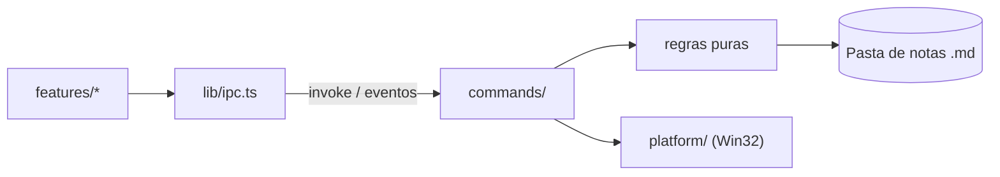

# Arquitetura

Estado atual e direção da etapa em curso. O que ainda não existe está marcado como _planejado_.

## Estrutura

```text
src/                     UI (Svelte 5 + Vite)
  App.svelte             Composição da tela, sem regra de negócio
  lib/ipc.ts             Único ponto que chama o Rust
  lib/features/<nome>/   Componentes, estado e testes de cada funcionalidade
  lib/ui/                Componentes visuais genéricos
  lib/styles/tokens.css  Cores, espaçamentos e tipografia
src-tauri/src/           Backend (Rust)
  lib.rs                 Só monta o app e registra módulos
  panel.rs               Máquina de estados pura do painel
  dock.rs                Thread que liga cursor, máquina de estados e janela
  commands/              Comandos Tauri: camada fina que delega
  platform/              Código específico de sistema operacional
```

Crie pastas quando a primeira funcionalidade precisar delas.

## Fluxo



## Painel

Protótipo da M0. `panel.rs` é uma máquina de estados pura, sem acesso ao Win32:

```text
Oculto → Armando (cursor na borda, aguardando) → Aberto → Fixado
```

`dock.rs` a liga à janela em uma única thread, que consulta o cursor, recebe os pedidos da UI e anima.
Assim, abrir, fechar e animar não disputam entre si. Coordenadas são pixels físicos, com consciência de
DPI por monitor (PMv2).

- **Gatilho:** consulta do cursor a cada 50 ms; a borda é a última coluna de pixels do monitor principal,
  com pausa de 150 ms. Uma janela fina na borda roubaria cliques de barras de rolagem e botões de
  janelas maximizadas. Pontos fora do monitor principal são ignorados.
- **Expansão:** a janela já existe com o tamanho final, estacionada logo após a borda, e desliza com
  `SetWindowPos`, sem redimensionar o WebView. Cada quadro espera o `DwmFlush` e a posição vem do tempo
  real, com alvo de 150 ms.
- **Monitor vizinho:** a região da janela é recortada na borda do monitor a cada quadro; estacionada,
  ela fica vazia. Assim o painel não aparece em um monitor à direita.
- **Foco:** a janela usa `WS_EX_NOACTIVATE` e `WS_EX_TOOLWINDOW` e abre sem ativar. O `pointerdown` na UI
  pede a ativação, que guarda a janela anterior; ao fechar, o foco volta a ela, salvo se o usuário já
  estiver em outro app. Se ela não existir mais, o foco vai para a área de trabalho.
- **Painel oculto:** a janela fica desabilitada. Só `WS_EX_NOACTIVATE` não basta: ao fechar o app em
  primeiro plano, o Windows ativava o painel fora da tela e o teclado ia para uma janela invisível.
- **Painel recolhido (_planejado_):** o WebView2 reduz o uso de memória enquanto oculto.
- **Limite do protótipo:** monitor e tamanho são lidos só ao iniciar; mudar resolução, DPI ou layout
  exige reiniciar o app.
